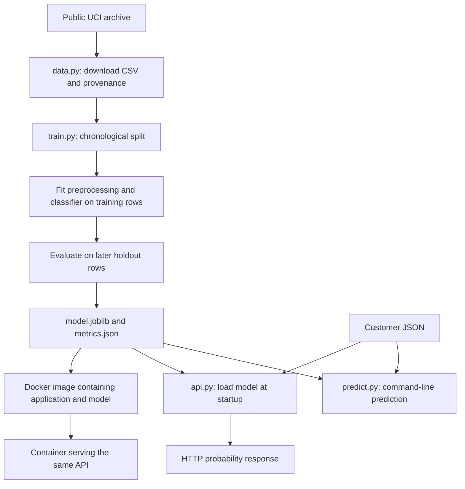
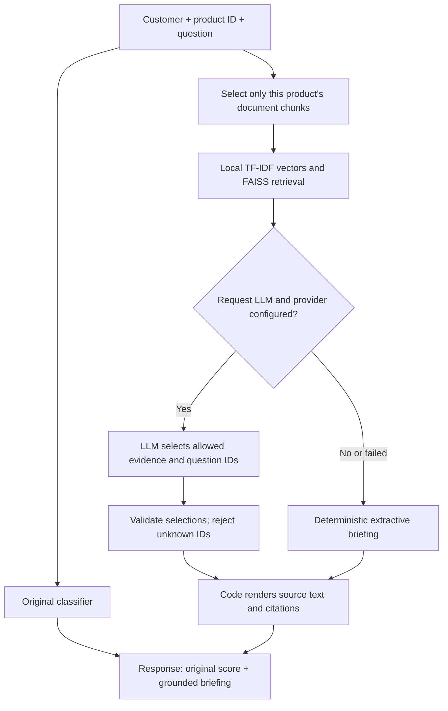

# Bank Customer Subscription ML Deployment

A single, step-by-step learning book: business problem, local development, model evaluation, APIs, Docker, CI/CD, AWS deployment design, monitoring, drift, retraining and scaling.

**Start here:** chapters 01–18 cover the currently implemented local/CI system; chapters 19–27 explain the full intended lifecycle and clearly label planned implementations. Chapters 28–32 provide troubleshooting, exercises, next steps, evidence and terminology. No AWS resources are created by reading or running the current local pipeline.

The same prediction service now includes **product-scoped FAISS retrieval and an optional LLM-curated briefing**. Try the enriched endpoint in chapter 33. It does not change the classifier score or retrain the model.

## Contents

- [01. Business problem and proposed solution](#01-business-problem-and-proposed-solution)
- [02. Scope, implementation status and cost](#02-scope-implementation-status-and-cost)
- [03. Architecture and the complete lifecycle](#03-architecture-and-the-complete-lifecycle)
- [04. Project files and their responsibilities](#04-project-files-and-their-responsibilities)
- [05. Terminal, Python and environment setup](#05-terminal-python-and-environment-setup)
- [06. Dataset, attribution and prediction timing](#06-dataset-attribution-and-prediction-timing)
- [07. Download and record the data](#07-download-and-record-the-data)
- [08. Customer fields and validation](#08-customer-fields-and-validation)
- [09. Preprocessing and model code](#09-preprocessing-and-model-code)
- [10. Train, evaluate and save the model](#10-train-evaluate-and-save-the-model)
- [11. Metrics, leakage and honest interpretation](#11-metrics-leakage-and-honest-interpretation)
- [12. Predict from the command line](#12-predict-from-the-command-line)
- [13. Serve predictions over HTTP](#13-serve-predictions-over-http)
- [14. Tests and failure behaviour](#14-tests-and-failure-behaviour)
- [15. Docker build and container execution](#15-docker-build-and-container-execution)
- [16. Git, GitHub and change history](#16-git-github-and-change-history)
- [17. CI pipeline explained step by step](#17-ci-pipeline-explained-step-by-step)
- [18. Verify the complete implemented pipeline](#18-verify-the-complete-implemented-pipeline)
- [19. Batch prediction and new data design](#19-batch-prediction-and-new-data-design)
- [20. Model versions, approval and release design](#20-model-versions-approval-and-release-design)
- [21. AWS foundations and service responsibilities](#21-aws-foundations-and-service-responsibilities)
- [22. EC2 deployment path](#22-ec2-deployment-path)
- [23. SageMaker training and endpoint path](#23-sagemaker-training-and-endpoint-path)
- [24. Continuous delivery, deployment and rollback](#24-continuous-delivery-deployment-and-rollback)
- [25. Monitoring, data drift and delayed outcomes](#25-monitoring-data-drift-and-delayed-outcomes)
- [26. Retraining and improvement decisions](#26-retraining-and-improvement-decisions)
- [27. Scaling, reliability and cost decisions](#27-scaling-reliability-and-cost-decisions)
- [28. Troubleshooting and recovery](#28-troubleshooting-and-recovery)
- [29. Exercises and interview checkpoints](#29-exercises-and-interview-checkpoints)
- [30. Implementation sequence from here](#30-implementation-sequence-from-here)
- [31. Validation evidence and measured limitations](#31-validation-evidence-and-measured-limitations)
- [32. Glossary](#32-glossary)
- [33. Integrated product retrieval and optional LLM briefing](#33-integrated-product-retrieval-and-optional-llm-briefing)

## 01. Business problem and proposed solution

A bank offers a term deposit: a customer places money with the bank for an agreed period. The bank has historical marketing results and wants to prioritise future contacts. Our model estimates subscription likelihood before the current call.

The input is one customer's known information. The output is a number between 0 and 1. The application does not contact customers, approve loans, move money, or guarantee a subscription. The example JSON is fictional. Our model is a learning baseline, not an approved banking system.

“End to end” has a specific scope here: downloading data, training, evaluating, saving, loading, serving through HTTP, packaging in Docker, and automatically checking those steps on GitHub. Persistent cloud deployment is not implemented yet. See the final section for the remaining learning path.

In a real team, the business owner defines calling capacity and costs; a data engineer supplies reliable records; a data scientist evaluates models; and an ML/platform engineer deploys and operates the system. One person may cover several roles in a small team. This project lets you practise those responsibilities at learning scale.

A useful objective is “find more subscribers within the same calling capacity.” If agents can call only 500 customers tomorrow, ranking the daily list and evaluating precision/recall at that capacity may be more useful than applying a universal 0.5 threshold. Predicting subscription is not the same as predicting the extra benefit caused by calling: that would require a different causal/uplift design and suitable evidence.

## 02. Scope, implementation status and cost

This README is the single learning document. Read it from top to bottom; the contents below are shortcuts within this same file. Commands are tested for this macOS/Linux project setup. Do not paste every code block at once: servers occupy a terminal until stopped.

| Capability | Status |
| --- | --- |
| Public data download, preprocessing, training, evaluation | Implemented and tested |
| Saved model, command-line prediction, FastAPI service | Implemented and tested |
| Docker packaging and GitHub CI with real HTTP checks | Implemented and tested |
| FAISS product retrieval, cited excerpts, optional constrained LLM curation | Implemented; live provider call requires configuration |
| Batch scoring CLI, dataset/model registry, release manifests | Planned |
| SageMaker-compatible local adapters and AWS deployment | Planned |
| Monitoring, delayed-label evaluation, drift and retraining | Planned |

“Implemented” means executable project code exists. “Planned” means the concepts are explained here but working implementation and verification remain to be done. The later cloud/operations chapters teach the intended design; they are not executable deployment runbooks.

No AWS resources have been created. Current training and serving run on your laptop, and CI runs on temporary GitHub runners. This repository is public; standard hosted runners for public repositories are free, while storage and other runner types have separate billing rules. Actual EC2/SageMaker usage cannot be guaranteed free without credits or a suitable sandbox. A budget alert is not a spending cap.

## 03. Architecture and the complete lifecycle



**Training path:** many labelled rows become a fitted model and a report. Training is typically a separate job that finishes and exits.

**Serving path:** a running program receives a customer, checks it, transforms it with saved preprocessing, and predicts. It keeps running to handle more requests. It does not train on incoming requests.

**Automation path:** GitHub starts a temporary computer that repeats tests, training and container checks. That computer is removed after the job. It is not a permanent prediction server.

The intended full lifecycle is: business goal → versioned raw data → validation → training/validation/test → evaluated candidate → approval → versioned release → serving → monitoring → delayed outcomes → investigation → candidate retraining. Monitoring feeds back into development; it is not the last task before forgetting the model.

## 04. Project files and their responsibilities

| File or directory | Why it exists | Committed to Git? |
| --- | --- | --- |
| `pyproject.toml` | Package metadata and dependency requirements | Yes |
| `src/bank_ml/` | Importable application code | Yes |
| `tests/` | Repeatable checks with synthetic data | Yes |
| `scripts/check_api.py` | Smoke-check numerical and enriched predictions over HTTP | Yes |
| `src/bank_ml/rag.py` | FAISS retrieval, evidence rendering, optional LLM curation | Yes |
| `src/bank_ml/knowledge/deposits.json` | Fictional versioned product passages | Yes |
| `scripts/evaluate_retrieval.py` | Small retrieval regression set | Yes |
| `.env.example` | Placeholder provider configuration, never real secrets | Yes |
| `examples/customer.json` | Fictional valid input | Yes |
| `data/` | Downloaded raw CSV and provenance | Only its placeholder |
| `artifacts/` | Generated model and metrics | No |
| `docs/baseline-metrics.json` | Explicit historical learning evidence | Yes |
| `.venv/` | Machine-specific Python environment | No |
| `.git/` | Local repository history and configuration | Managed by Git, never stage as application data |
| `.gitignore` | Prevent generated and sensitive files being staged by default | Yes |
| `.dockerignore` | Limit files sent to Docker build | Yes |
| `.github/workflows/ci.yml` | Instructions GitHub executes | Yes |
| `infra/` and `notebooks/` | Reserved for future infrastructure and exploration | Empty folders may not appear on GitHub |

The `src/` layout separates importable code from the README and generated files. Installing the package lets `python -m bank_ml.train` find it without manually changing Python's import path.

## 05. Terminal, Python and environment setup

The terminal is an application where you type commands. Its current directory determines where files are read and written. Open a terminal in this project's root folder, the folder containing `pyproject.toml`.

On macOS, `pwd` prints the current folder and `ls` lists its contents. A command printed in a code block is something you can run; a filename in a paragraph is something you can open and read.


For a fresh clone, first run:

```bash
git clone https://github.com/subhashdixit/bank-customer-subscription-ml-pipeline.git
cd bank-customer-subscription-ml-pipeline
```

If you are already in the existing checkout, use it rather than cloning a second copy. On Windows, shell activation and path syntax differ; the current instructions and evidence cover macOS/Linux.

You need Python 3.10 or newer. Docker is needed only for the container lesson. Git records changes; GitHub hosts the repository online. You do not need an AWS account for these lessons.

```bash
python3 --version
pwd
ls
```

Expected: a supported Python version and project files. If a command is missing, use the troubleshooting guide rather than installing random packages.

```bash
python3 -m venv .venv
source .venv/bin/activate
python -m pip install --upgrade pip
python -m pip install -e '.[dev]'
```

`python3 -m venv .venv` creates a private set of Python tools in `.venv`. It does not create a virtual machine. `source` activates those tools in this terminal; activate again when you open another terminal. `python -m` runs a module using the selected Python interpreter.

`pip` installs libraries. `-e` means editable: when you change our Python source, the environment sees the changes. The quoted `.[dev]` means this project plus its development tools. Quotes prevent the shell treating brackets as filename patterns. `pyproject.toml` declares those requirements. Version ranges allow compatible updates; this is not a fully locked dependency environment.

Expected: installation finishes without an error. The `.venv` directory is ignored by Git because it is generated and specific to your machine. Do not use `sudo pip`.


## 06. Dataset, attribution and prediction timing

### Source and attribution

Dataset: Bank Marketing, UCI Machine Learning Repository, dataset 222.

Source: https://archive.ics.uci.edu/dataset/222/bank+marketing

Download: https://archive.ics.uci.edu/static/public/222/bank+marketing.zip

Creators credited by UCI: S. Moro, P. Rita, P. Cortez. Dataset DOI: https://doi.org/10.24432/C5K306

UCI lists the license as Creative Commons Attribution 4.0 International: https://creativecommons.org/licenses/by/4.0/

We use `bank-full.csv`, the original date-ordered 45,211-row version, not the 41,188-row `bank-additional-full.csv`. This project selects features and derives a binary label; it does not redistribute the raw dataset. Keep this attribution when reusing it.

### Prediction timing and features

The score is calculated before the current marketing contact. Features: age, balance, previous contact count, job, marital status, education, credit default, housing loan, personal loan, and previous campaign outcome. `unknown` is an explicit source category, not a missing Python value. New categories are encoded as all-zero indicators for that feature; prediction continues but may be less reliable.

We exclude duration because it is known only after the call. We also omit contact channel, current campaign count, day and month for a conservative first baseline. The source does not establish that every financial field was frozen at the exact scoring time. Historical leakage and repeated-customer effects therefore remain limitations. This is not a causal model.

### Evaluation

First 80% train, final 20% test, preserving source order. Do not shuffle these rows. This better resembles prediction on later campaigns than a random split, but record-level timestamps and customer IDs are absent from our selected source. The same person may appear across periods. No tuning is performed, and threshold 0.5 is only illustrative.

Average precision and ROC AUC describe ranking. Precision/recall at a fixed threshold describe a particular decision rule. The test positive rate is the random-ranking reference for average precision. Accuracy alone is not useful for this imbalanced target. Generated test fixtures validate code, not measured business performance.

### Intended use and limits

Educational demonstration only. No fairness audit, privacy review, probability calibration, modern population validation, or business cost analysis has been performed. Historical Portuguese bank marketing outcomes do not establish generalisation to other banks or countries. Age and marital information can raise important policy and fairness questions that must be assessed before operational use.

`joblib` model files must come from trusted builds because loading them can execute code. Model and preprocessing are serialized together. A different library version may be incompatible, so metrics record versions. Deployment should eventually use pinned dependencies, immutable model versions and explicit approval gates.

## 07. Download and record the data

```bash
python -m bank_ml.data
```

The program downloads a public ZIP from UCI, reads the original `bank-full.csv` from its nested ZIP, and saves it in `data/`. It also writes a `.source.json` file with a source URL, license and SHA-256 checksum. The checksum is a fingerprint: different bytes produce a different fingerprint. It records what we downloaded; it is not an independently verified authenticity signature.

Expected: `data/bank-full.csv` and `data/bank-full.source.json`. The CSV uses semicolons, so our reader explicitly uses `sep=";"`. This is real historical learning data, not a random fixture. Tests use generated examples so ordinary tests do not need internet access.

Read chapter 06 before changing the feature list. Exercise: open the CSV and locate `y`, the answer column, and `duration`, a column we deliberately exclude.

### `data.py`: bytes become a dataset

`URL` identifies the UCI download. `urlopen` performs an HTTPS request with a timeout. `ZipFile` reads the outer archive and the nested `bank.zip`. The code selects `bank-full.csv` and writes those bytes, rather than extracting arbitrary file paths from an archive. If UCI changes its archive structure, this code can fail and needs review.

`hashlib.sha256` fingerprints the CSV. The `.source.json` records that fingerprint, source and license. It does not independently authenticate the dataset or freeze future downloads. A rerun replaces these local output files. The loader reads the archive into memory, which is reasonable for this small dataset, not a general large-data download design.

## 08. Customer fields and validation

| Field | Type | Meaning in this source |
| --- | --- | --- |
| `age` | Integer, 18–120 in the API | Age in years |
| `balance` | Finite number | Average yearly balance in euros; negative values are permitted |
| `previous` | Nonnegative integer in the API | Contacts before the current campaign |
| `job` | Nonempty text | Job category, such as technician |
| `marital` | Nonempty text | Marital status category |
| `education` | Nonempty text | Education category |
| `default` | Nonempty text | Whether credit is in default |
| `housing` | Nonempty text | Whether a housing loan exists |
| `loan` | Nonempty text | Whether a personal loan exists |
| `poutcome` | Nonempty text | Previous campaign outcome, including unknown |

These definitions describe the historical dataset; they are not a recommended production feature policy. See chapter 06 for fairness and timing limitations. `y` is the training answer, yes/no. It must not be submitted as a prediction feature.

The API forbids extra fields and validates types and ranges with Pydantic. The internal DataFrame validator selects known features and checks missing, finite and basic range values. It intentionally drops other CSV columns. These interfaces are not identical: the internal validator accepts some numeric conversions and does not require integer counts; the public API has integer fields. Categorical fields are not restricted to a fixed vocabulary; unseen categories are allowed and may reduce reliability.

## 09. Preprocessing and model code

### `model.py`: establish a shared contract

`NUMERIC` and `CATEGORICAL` define the feature lists. `validate_frame` selects those fields, rejects missing values, converts numeric values and checks finiteness and ranges. A pandas DataFrame is a table with named columns, similar to a spreadsheet held in memory.

`StandardScaler` learns each numeric column's mean and spread on training data. `OneHotEncoder` represents text categories with indicator columns. For example, a job could become separate technician and administrator indicators. `ColumnTransformer` sends each column group through the appropriate transformation.

`Pipeline` connects preparation and logistic regression into one object. `fit` learns preparation settings and model weights; `predict_proba` applies them to new rows. Logistic regression combines transformed values into a score and maps it to a value between zero and one. It is a classification algorithm despite its name.

## 10. Train, evaluate and save the model

```bash
python -m bank_ml.train
```

The program reads the data, checks required columns and values, and selects a conservative set of pre-contact features. It keeps the earlier 80% of records for training and later 20% for testing because the source file is date ordered.

Numeric features are scaled so a large balance does not have a large numerical influence merely because it uses larger units. Text categories become numeric indicators through one-hot encoding. Both operations are fitted on training rows only. A logistic regression classifier then learns a score from those transformed values.

These operations are saved together as a scikit-learn Pipeline. A new customer must receive exactly the same transformations as training customers. Saving just the classifier would lose that preparation.

Outputs:

- `artifacts/model.joblib`: fitted preprocessing and model.
- `artifacts/metrics.json`: evaluation, feature list, source checksum and software versions.

Read average precision alongside the test subscription rate. A random ranking has expected average precision around the positive rate, though finite samples vary. ROC AUC measures ranking across thresholds. Precision answers “of the customers flagged, how many subscribed?” Recall answers “of the subscribers, how many were flagged?” We report precision and recall at 0.5 as a demonstration, not a business-approved calling threshold.

We fix the model settings before evaluating the holdout. There is no tuning or validation set in this first baseline. If we later tune settings, we must add a validation period and preserve a fresh final test period. Repeatedly adjusting the model based on test results turns the test set into development data.

Exercise: find train/test row counts in the JSON. Explain why the test rows must not be used to fit the scaler.

### Training code walkthrough


`argparse` reads optional `--data` and `--output` command arguments. `Path` handles file locations. Pandas loads the semicolon-separated CSV. The code checks yes/no labels, a minimum row count and that both chronological partitions contain both outcomes.

The first 80% is training data; the final 20% is the holdout. The scaler, encoder and classifier learn only from training rows. `predict_proba(... )[:, 1]` selects the probability for class 1, which is subscription because yes was converted to 1 and no to 0.

Metrics describe the holdout. `joblib.dump` serializes the fitted pipeline so another process can load it. The JSON report records selected/excluded columns, source checksum and software versions. Training currently overwrites the selected output directory's model and report. Use a different `--output` directory to keep an experiment separate, but remember that the API must then be pointed at its model.

## 11. Metrics, leakage and honest interpretation

Suppose 100 customers include 10 actual subscribers. A model flags 8 people and 4 of them are subscribers. Precision is 4/8 = 50%; recall is 4/10 = 40%. Those are different questions. Calling more people may increase recall while reducing precision; the business must choose the trade-off using validation data and costs.

| Report field | Meaning | Limitation |
| --- | --- | --- |
| `test_subscription_rate` | Fraction of yes labels in holdout | Describes this period only |
| `average_precision` | Summary of precision across recall levels | Depends on class prevalence |
| `roc_auc` | Ranking quality across thresholds | Does not establish useful calling economics |
| `precision_at_0_5` | Fraction of flagged customers who subscribed | Depends on the chosen threshold |
| `recall_at_0_5` | Fraction of subscribers flagged | Can be low even when precision is high |

Read the measured [validation record](#31-validation-evidence-and-measured-limitations). It reports weak recall at 0.5 and a large subscription-rate difference between time periods. There is no automatic model-quality gate, tuning, probability calibration, or fairness evaluation. CI passing proves the implemented technical checks passed, not that the model is suitable to use in a bank.

Fitting preprocessing on all rows leaks information about later records. Including call duration leaks knowledge unavailable before the call. Tuning repeatedly against holdout scores leaks evaluation feedback into development decisions.

The current fixed baseline uses no validation set because it does no tuning. Before comparing many models, create separate chronological training, validation and test periods. Model selection belongs on validation data; final evaluation belongs on untouched test data. Date order is a useful approximation here, but missing customer identifiers limit our ability to exclude repeated customers across periods.

## 12. Predict from the command line

```bash
python -m bank_ml.predict --input examples/customer.json
```

JSON is a text format made of named fields and values. Our example customer is fictional. The program loads the saved model, checks the inputs, and prints a probability between zero and one. It does not retrain.

The probability is uncalibrated and based on this historical training distribution. Do not interpret a score as guaranteed real-world odds.

Exercise: copy the example into another local JSON file and change a field. Run the prediction with `--input` pointing at that file. A changed result is an association learned by the model, not proof that changing that characteristic causes subscription.

### Prediction code walkthrough


The CLI reads one customer object from JSON and wraps it in a list. The shared function also accepts multiple row objects internally, but no batch-file CLI is implemented. It validates a DataFrame and returns one probability object per row.

`joblib.load` must receive a trusted file: serialized Python objects can execute code when loaded. The saved model includes preprocessing; do not manually rescale API inputs yourself.

## 13. Serve predictions over HTTP

```bash
python -m uvicorn bank_ml.api:app --host 127.0.0.1 --port 8000
```

Uvicorn is the server process. `bank_ml.api:app` identifies the application object in our code. `127.0.0.1` means your own computer; `8000` is the listening port, like a numbered door for network requests. Keep this terminal open while you use the API.

Open http://127.0.0.1:8000/docs in a browser. FastAPI generates this interactive interface from our input schema. Expand `POST /predict`, choose “Try it out”, paste the example JSON, and execute.

In a second terminal opened in the project root, you can also run:

```bash
curl http://127.0.0.1:8000/health
curl -H 'Content-Type: application/json' --data @examples/customer.json http://127.0.0.1:8000/predict
```

`curl` sends HTTP requests. `--data @file` reads the request body from a file and uses POST. `Content-Type` tells the server how to read the body. GET `/health` asks whether the process is ready. POST `/predict` submits customer information. HTTP 200 means success; 422 means invalid input.

The model loads once at startup. Missing model files stop startup instead of returning fabricated predictions. Stop the server with Control+C. This development API has no authentication or rate limits and should not be exposed publicly.

### API code walkthrough


`Customer` defines the request body schema. FastAPI uses it to validate input and generate `/docs`. `lifespan` loads the model once at startup using `MODEL_PATH`, or its default path. If loading fails, startup fails. The application never silently substitutes an untrained model.

GET `/health` returns readiness for this simple application. It does not assess model quality or recheck disk contents on every request. POST `/predict` uses the already loaded model and converts ordinary validation failures to HTTP 422. Updating a model file on disk does not reload it into an already running process; restart that process or deploy a new container.

## 14. Tests and failure behaviour

```bash
python -m pytest -q
```

Tests are programs that check expected behaviour. We test the full training/save/load/predict path, valid and invalid API requests, unfamiliar job categories, exclusion of call duration, and failure when the model is missing. These tests check software behaviour, not whether the model is commercially useful or fair.

Exercise: send an age of -1 to the API. Explain why it is better to reject it than silently produce a score.

The tests generate synthetic labelled rows, train into a temporary directory and load the resulting model. The API tests use an in-process client; the later smoke test sends real HTTP requests to a running container. Both are useful because an in-process test does not prove the Docker entry point or network path works.

These are software checks. Model-quality gates, load tests and fairness evaluation are different checks. Chapter 33 adds retrieval, LLM-response validation and graceful-failure tests; the historical four-test record in chapter 31 describes the original baseline.

## 15. Docker build and container execution

First train the model. Start Docker Desktop and wait until its engine is ready.

```bash
docker build -t bank-ml:local .
docker run --rm --name bank-ml -p 127.0.0.1:8000:8000 bank-ml:local
```

The build reads `Dockerfile`, installs the application, and includes the trained model. The image is a packaged template; the container is a running instance. `.dockerignore` limits which local files enter the build context. The application runs as a non-root user.

The port mapping forwards laptop port 8000 to container port 8000. The server listens on `0.0.0.0` inside the container so Docker can reach it; the published laptop port is restricted to localhost. Stop any Python API already using that port first.

Run the same curl requests. Stop the container with Control+C. `--rm` removes this stopped container; the reusable image remains. Retraining a local model does not alter an existing image: rebuild it to include the new model.

A container provides a consistent application environment. It does not automatically provide IAM permissions, TLS, monitoring or production security.

| Instruction | Effect |
| --- | --- |
| `FROM python:3.11-slim` | Start with a Linux image containing Python |
| `WORKDIR /app` | Set the directory for later instructions and startup |
| `COPY pyproject.toml` and `COPY src` | Include package definition and source |
| `RUN pip install ...` | Install runtime dependencies during build |
| `useradd` and `USER appuser` | Run the final service without root privileges |
| `COPY artifacts/model.joblib` | Freeze this model into the image |
| `EXPOSE 8000` | Document the intended container port; does not publish it |
| `CMD ... uvicorn` | Start the API when the container runs |

Training happens before this build. ECR is not involved locally. `docker run -p 127.0.0.1:8000:8000` publishes the port to your laptop only. Inside the container, Uvicorn listens on all container interfaces so Docker forwarding can reach it. The image bundles a model; changing the host file afterwards does not change that image.

The base-image tag and dependency ranges can change over time. This project has not yet locked every dependency or pinned the base-image digest. A production release should capture those identities and train using the same environment used for serving. Successful cross-version loading in one test is not a general compatibility promise.

## 16. Git, GitHub and change history

Git is local history. GitHub stores a remote copy and runs automation. A commit is a named snapshot of tracked files. Generated data, environments, models and credentials should not be in those snapshots.

```bash
git status
git diff
git add src docs tests README.md
git commit -m "Explain the change you made"
git push
```

Read `git diff` before staging. `git add` selects changes; `git commit` saves them locally; `git push` sends commits to the configured remote. The first publication is handled as part of project setup. Do not rerun repository creation commands for every change.

## 17. CI pipeline explained step by step

The current job uses Ubuntu 24.04 and Python 3.11. GitHub's action runtime is separate from application Python: checkout/setup actions use Node.js internally, while our model runs in Python.

| Workflow component | What happens | Typical failure |
| --- | --- | --- |
| `on` | Start on push, pull request or manual dispatch | Actions disabled or YAML invalid |
| `permissions` | Give automation read access to repository contents | Unneeded write operations are rejected |
| `runs-on` | Allocate a temporary Linux runner | Runner service unavailable |
| `timeout-minutes` | Stop a job that exceeds 15 minutes | Slow dependency or data service |
| Checkout action | Retrieve this commit's files | Repository access or action service issue |
| Setup Python action | Select Python 3.11 | Runtime download problem |
| Install | Build our package and install dependencies | Dependency resolution/network error |
| Pytest | Check code using generated data | Behaviour differs from assertions |
| Download | Fetch real UCI data | External source unavailable |
| Train | Fit and evaluate on real data | Schema/label error |
| Predict | Load artifact and score example | Model or input mismatch |
| Build | Package application and model | Missing artifact or failed installation |
| Smoke check | Start container and probe actual HTTP requests | Startup, routing, contract or model mismatch |

The readiness loop tries `/health` up to 30 times, waiting two seconds between attempts. Once ready, `scripts/check_api.py` checks health JSON, a finite probability in range, numerical agreement with the host model, and rejection of an invalid age. A trap prints container logs and removes the temporary container when the shell exits, including when a check fails. Model comparison uses a small numerical tolerance to allow tiny floating-point differences.

The smoke script also checks `/predict/briefing`: the numerical score must match `/predict`, and citations must belong to the requested product. The workflow runs six small retrieval regression checks before training.

The smoke script accepts `--url` for another local port and expects to run from the project root with the matching host artifact. A mismatch can indicate that the image contains an older model. It is stronger than merely checking that HTTP returned success.

This is continuous integration. There is no registry push, persistent deployment, release approval, rollback automation or AWS authentication yet. The workflow does not retain its trained model as a downloadable release artifact. CI currently retrains on every triggering change, including documentation pushes unless explicitly skipped. This is simple for learning but inefficient for a larger project.

Updated action runtime references: [checkout](https://github.com/actions/checkout), [setup-python](https://github.com/actions/setup-python). Billing reference: [GitHub Actions billing](https://docs.github.com/en/billing/concepts/product-billing/github-actions).

## 18. Verify the complete implemented pipeline

Follow chapters 05, 07 and 10 to set up, download and train first. From the activated project environment:

```bash
python -m pytest -q
python -m bank_ml.train
python -m bank_ml.predict
docker build -t bank-ml:local .
docker run --rm --name bank-ml -p 127.0.0.1:8000:8000 bank-ml:local
```

In another terminal at the project root:

```bash
source .venv/bin/activate
python scripts/check_api.py
```

Expected: a PASS message describing the checked behaviour. Stop the foreground container with Control+C. The image remains available for reuse. If port 8000 is occupied, map laptop port 18000 instead and run the smoke script with `--url http://127.0.0.1:18000`.

After pushing code, open GitHub → repository → Actions → Test and build → latest run. Check its commit matches your change, expand failing steps, and read the first meaningful error. A green older run does not validate newer untested code. Documentation-only commits can use `[skip ci]`; do not use that to bypass verification of code changes.

## 19. Batch prediction and new data design

**Planned implementation.** For this bank problem, a daily ranked calling list is a natural product. Online serving is useful when another application needs an immediate score; batch serving scores a whole file on a schedule.

A batch workflow should receive a dated customer snapshot, validate it, load an approved model once, score in manageable chunks, and write customer identifiers, scores, model version and scoring timestamp. Sort eligible customers by score and apply calling-capacity and business rules separately. The current Python prediction function can score several row objects, but a batch-file CLI, stable customer identifiers and scheduled delivery are not implemented.

New input data and new labelled training data are different. A customer can be scored today without knowing the outcome. Preserve source/event time so tomorrow's information cannot accidentally enter today's features. Keep raw data immutable, write cleaned data separately, quarantine invalid rows with reasons, and record schema versions and checksums. Reprocessing the same batch should not create duplicate outputs; this is called idempotency.

When actual outcomes arrive, join them to prediction records using a stable identifier and an agreed observation window. Do not automatically label an unfinished campaign as “no.” Labels may be missing or delayed, and customers whom the bank never calls may have no comparable observed outcome. Selection bias limits conclusions from those records.

## 20. Model versions, approval and release design

**Planned implementation.** A model registry is a catalogue of candidates and their evidence, not just a folder of arbitrary filenames. A local manifest can teach this concept before connecting to a managed registry.

A release should identify the source commit, dataset checksum/version, feature schema, training configuration, dependency environment, model checksum, evaluation report and container image digest. A label such as “latest” is not enough to reproduce a release.

Use candidate → evaluated → approved → deployed states. Compare a new candidate against the current model on the same appropriate validation period. Reject broken schemas, unacceptable performance and missing evidence. Do not use a final test set repeatedly as the promotion score. Define business thresholds before examining the final result.

Development is where changes happen; staging rehearses release checks; production serves real users. They should have separate data and permissions. A release changes only after approval. Keep the previous image/model identity so rollback can restore a known combination. Merely overwriting `model.joblib` loses that history; the current baseline still overwrites its selected output directory.

## 21. AWS foundations and service responsibilities

**Conceptual design; cloud implementation is planned.** AWS is a collection of services with separate responsibilities. Deploying “to AWS” means choosing, securing and connecting them.

| Concept/service | Simple meaning | Role here |
| --- | --- | --- |
| Account and region | Administrative boundary and geographic service location | Choose where resources and billing live |
| IAM role and policy | An assumable identity and allowed actions | Let a job read specific data and write specific outputs |
| S3 bucket and object key | Object storage container and item name | Raw data, prepared data, models, reports |
| ECR | Container image registry | Store versioned images used by compute |
| EC2 and EBS | Virtual machine and attached block storage | Self-managed serving and its disk |
| VPC and subnet | Private network and a segment within it | Place compute and control routing |
| Security group | Stateful network access rules attached to resources | Limit who can reach the service |
| SageMaker AI | Managed ML training and hosting capabilities | Jobs, model registration and inference hosting |
| CloudWatch | Logs, metrics and alarms | Detect operational problems |
| EventBridge or a scheduler | Trigger work at a time or on an event | Batch runs and monitoring jobs |
| DNS and TLS | Service naming and encrypted connections | Stable HTTPS address for an application |
| Infrastructure as code | Versioned resource definitions | Reproducible environment setup and teardown |

A security group controls network traffic; an IAM policy controls authorised API operations. Neither replaces the other. A public S3 bucket is not required for an application to read data: give its role narrowly scoped access. An EC2 security group is not API authentication. An internet-facing service also needs an appropriate authentication and TLS design.

The proposed GitHub deployment uses OIDC identity federation to obtain temporary AWS credentials. The role's trust policy should restrict which repository, branch or environment can assume it; its permission policy should restrict resources and actions. Do not place long-lived AWS keys in source files. Secrets, encryption and access logging need explicit design before handling real customer data.

These explanations introduce the AWS concepts needed for this project; they are not coverage of every AWS service. [AWS IAM introduction](https://docs.aws.amazon.com/IAM/latest/UserGuide/introduction.html), [S3 introduction](https://docs.aws.amazon.com/AmazonS3/latest/userguide/Welcome.html), [EC2 concepts](https://docs.aws.amazon.com/AWSEC2/latest/UserGuide/concepts.html).

## 22. EC2 deployment path

**Planned implementation.** EC2 gives us a computer; we manage the application on it.

1. Build and test a specific image, then publish it to ECR.
2. Provision a suitably sized instance, disk, network and narrowly scoped instance role through infrastructure as code.
3. Configure the machine to retrieve the image without embedding credentials. Pull the selected immutable image version.
4. Start the container under a service supervisor with restart behaviour and bounded resource/log usage.
5. Provide a controlled ingress path with TLS and authentication as needed. Keep management access restricted.
6. Check health and predictions before directing users to the new release. Record the image/model identity.
7. Send logs and metrics to monitoring, then rehearse restart and rollback.
8. Remove resources when the exercise ends and verify there are no remaining chargeable resources.

For higher availability, more than one instance behind a load balancer can distribute requests, while an Auto Scaling group adjusts capacity. That adds cost and operational complexity; it is not needed for the first local milestone. A single EC2 VM remains a single point of failure. Updating dependencies, operating-system patches, service restart and deployment safety remain our responsibilities.

## 23. SageMaker training and endpoint path

**Planned implementation.** A real SageMaker endpoint is a managed AWS resource. We can implement compatible container behaviour locally, but that cannot verify the managed service, IAM, networking or autoscaling.

A managed training workflow selects training input in S3, a container image, compute settings and an execution role. SageMaker starts the job, makes data available according to the configured input mode, runs training and collects the output. For a custom training container, standard locations include input channels under `/opt/ml/input/data/` and saved model files under `/opt/ml/model`. These differ from our current `data/` and `artifacts/` defaults and need adapters before claiming compatibility.

For standard custom real-time inference, the container serves on port 8080 and supports `/ping` health checks and `/invocations` inference requests. SageMaker places extracted model artifacts under `/opt/ml/model`. Our current FastAPI container uses port 8000, `/health`, `/predict`, and a baked-in model path, so it is not yet that adapter. We should add compatible routes/configuration and test them locally. [AWS custom inference contract](https://docs.aws.amazon.com/sagemaker/latest/dg/your-algorithms-inference-code.html).

The classic endpoint deployment flow creates a SageMaker Model definition linking the image, artifacts and role; an endpoint configuration selecting model variants and capacity; and an endpoint using that configuration. A trusted application calls the SageMaker runtime using AWS-authorised requests. A SageMaker endpoint is not automatically a public anonymous website; a public product needs an application/authentication layer as appropriate.

Local practice should verify input/output contracts, model loading, error behaviour and container startup. SageMaker SDK local mode can exercise supported jobs using Docker, but inspect its configuration because some operations still contact AWS. [AWS local pipeline documentation](https://docs.aws.amazon.com/sagemaker/latest/dg/pipelines-local-mode.html).

Managed hosting reduces machine-management work but still requires our choices about capacity, security, deployment, metrics, costs and cleanup. EC2 hosting and SageMaker hosting are two learning paths; we do not need both to answer the same production request.

## 24. Continuous delivery, deployment and rollback

**Planned implementation beyond current CI.** CI checks code. Continuous delivery keeps an approved release ready; continuous deployment automatically promotes qualifying changes. Our present workflow stops after testing a temporary container.

The intended extension is: test → build/version image → push ECR → select approved model → deploy staging → smoke/load checks → approval → deploy production → observe → promote or roll back. The application release and model release have separate identities: a code-only fix need not retrain, and a new dataset may produce a model with unchanged API code.

Blue/green deployment runs an old and new environment and switches traffic after checks. A canary sends a small share of traffic to the candidate before wider rollout. Shadow testing sends copies of requests to a candidate without using its answers for business decisions. A/B testing measures outcomes across assigned groups; it needs careful experimental design and enough matured outcomes.

Rollback should restore a previous compatible image, model and schema configuration. It does not undo calls already made or repair corrupted data. If schema compatibility is broken, traffic may need to stop until a safe version is available. Release gates should check error rate, response time and technical correctness immediately; delayed business metrics require a longer observation period.

## 25. Monitoring, data drift and delayed outcomes

**Planned implementation.** Three monitoring layers answer different questions.

| Layer | Observe | Example response |
| --- | --- | --- |
| Service | Request count, error rate, latency percentiles, CPU/memory, restarts | Investigate slow dependencies or add capacity |
| Data | Missing values, ranges, category frequencies, schema failures | Quarantine broken input; investigate upstream changes |
| Model/business | Precision/recall, calibration, top-k yield and outcomes by group | Evaluate degradation and candidate improvements |

Average latency can hide slow requests; p95 is a time below which 95% of observed requests complete. Choose service targets based on user needs and test realistic traffic. Log request ID, timestamp, release/model ID and error category without exposing unnecessary customer details. Do not indiscriminately log bank input payloads. Retention and access rules matter.

Data drift is a change in input distributions. For example, later campaigns might include many more retired customers. Concept drift means the relationship between inputs and outcomes changed: similar customers now respond differently. Changes in prediction-score distribution are another signal. None alone proves the model is wrong or identifies the cause.

A local monitor can compare current numeric summaries, categorical frequencies, missingness and out-of-range rates against a versioned reference window. Statistical measures such as PSI, KS tests or distribution distances can help, but thresholds depend on sample size, binning, seasonality and practical impact. Tiny batches create unstable alerts; large samples can make unimportant differences statistically significant.

Performance monitoring requires actual outcomes joined to predictions. Define a maturity window, measure label coverage and avoid classifying unobserved outcomes as failures. Keep separate reports by model version and relevant population segments so an overall average does not hide local degradation.

The cloud design can capture approved telemetry into S3, run scheduled monitoring jobs, publish metrics and send actionable alarms through the selected monitoring stack. AWS monitoring options have service/account availability constraints; verify current documentation when implementing them rather than assuming a particular managed monitor is available. [AWS monitoring overview](https://docs.aws.amazon.com/sagemaker/latest/dg/model-monitor.html).

An alert should include what changed, the affected period/version, evidence and the next investigation step. It should not automatically replace a model because one drift threshold was crossed.

## 26. Retraining and improvement decisions

**Planned implementation.** Retraining may be scheduled, triggered by sufficient new labelled data, or requested after investigation. A drift alert starts an investigation; it is not an automatic instruction to train and deploy.

A controlled workflow checks label maturity and data quality, versions the training snapshot, trains a candidate, compares it fairly, reviews fairness/calibration and business constraints, then approves or rejects it. Keep the existing serving model when the candidate fails. Preserve evidence even for rejected experiments.

Possible improvements include better point-in-time features, better labels, more representative data, regularisation, a different algorithm, calibrated probabilities, a threshold tied to calling capacity, and more efficient batch processing. A more complex model is not automatically an improvement.

| Scenario | Investigate first | Possible action |
| --- | --- | --- |
| Many invalid requests | Input schema and upstream producer change | Fix contract/producer; do not retrain on broken rows |
| More unknown job categories | Category source and population coverage | Update schema/features and evaluate a candidate |
| Drift with stable measured performance | Seasonality, sample size, reference window | Observe with documented justification |
| Performance drops after outcomes mature | Data/label quality, selection bias, changed relationships | Build and compare a candidate |
| New release returns errors | Container/model compatibility and configuration | Roll back the release |
| High scores but few subscriptions | Calibration, policy, outcome window, population shift | Re-evaluate decision policy and model |
| New model is worse | Split validity, features and training behaviour | Reject it; retain the approved model |

Never feed the model's own predictions back as if they were verified customer outcomes. Doing so can reinforce mistakes. Changes to who gets called also change which outcomes we observe; record that selection policy.

## 27. Scaling, reliability and cost decisions

**Conceptual design.** Identify the bottleneck before adding infrastructure.

For online serving, measure concurrent requests, latency, memory and CPU. More workers can increase throughput but also duplicate model memory. Stateless replicas allow a load balancer to distribute requests; request-specific state should not depend on one container's local memory. Autoscaling takes time, so safe minimum capacity and burst behaviour matter. We have not implemented or load-tested this architecture.

For batch scoring, load the model once per process, process chunks, and write partitioned outputs rather than loading every customer into memory at once. Parallel execution needs stable IDs, retry-safe output handling and deterministic release selection. For larger training data, optimise data preparation and consider suitable algorithms before assuming distributed training is necessary.

Set timeouts and bounded retries for appropriate transient failures. Retry only operations that are safe to repeat, with backoff; endless retries can amplify an outage. Define a fallback: a previous approved model, a transparent business rule, or refusing to score until safe. Do not manufacture predictions during an outage.

Cloud costs include more than training time: endpoint/instance runtime, attached disks, snapshots, S3 objects, ECR storage, log retention, public IPs, load balancers and data transfer may all matter. Stopping compute can leave storage and other resources behind. Cleanup must be documented beside resource creation and verified afterwards. Check current region/account-specific prices before actual deployment. [SageMaker pricing](https://aws.amazon.com/sagemaker/ai/pricing/).

## 28. Troubleshooting and recovery

Read the final error line, identify the stage that failed, then check the items below. Do not paste tokens or private customer data into logs or issues.

| Symptom | Likely reason | Fix |
| --- | --- | --- |
| `python: command not found` | Environment not activated or only python3 exists | Run `python3 --version`, create the venv and activate it |
| `No module named bank_ml` | Wrong interpreter or installation missing | Activate `.venv`, run `python -m pip install -e '.[dev]'` from project root |
| Editable install says setup.py is missing | Old pip cannot install this pyproject | Run `python -m pip install --upgrade pip`, then retry |
| `no matches found: .[dev]` | zsh interpreted square brackets | Quote the argument: `'.[dev]'` |
| Dataset download fails | Offline, UCI unavailable, proxy or certificate issue | Check network, retry later; never disable TLS verification |
| Model file not found | Training has not completed or wrong working directory | Run `python -m bank_ml.train` in project root; inspect artifacts |
| API exits before starting | Missing or incompatible trusted model | Read startup error; retrain in the same environment |
| Address already in use | Another process uses port 8000 | Stop the earlier server with Control+C or choose another port |
| HTTP 422 | Input violates required fields, types or ranges | Start from examples/customer.json; read the response detail |
| Docker daemon unavailable | Docker Desktop engine stopped or inaccessible | Start Docker Desktop, wait, then run `docker info` |
| Docker build cannot find model.joblib | Model not trained before build | Train first; inspect artifacts/model.joblib |
| Git push says authentication failed | GitHub login missing or invalid | Run `gh auth login` interactively; do not put credentials in repository files |
| CI fails in download step | External dataset source unavailable | Read the logs and rerun later; tests themselves are offline |
| CI does not start | Actions disabled or billing allowance exhausted | Check repository Actions settings and account billing |

### Collect useful debugging information

Run from the project root:

```bash
pwd
python --version
python -m pip --version
python -m pytest -q
git status
```

For containers, run `docker ps` to see running containers and `docker logs bank-ml` to read logs while the named container exists. Do not solve a port problem by opening your machine to the internet.

### Rebuild safely

A virtual environment can be recreated from project dependencies. Do not delete project source, datasets or Git history while troubleshooting. Generated models can be recreated by training. A model trained in one library environment may not load in a different one: rebuild it using the intended runtime.

## 29. Exercises and interview checkpoints

| Exercise | Expected lesson |
| --- | --- |
| Send age -1 through `/docs` | HTTP 422; validation happens before prediction |
| Omit `job` | Missing required input is rejected |
| Add `duration` to the API input | Extra fields are rejected by the API |
| Use a new job category | Request is accepted; unknown-category encoding does not imply reliability |
| Start with `MODEL_PATH` pointing at a nonexistent file | Startup fails; health never becomes ready |
| Change a local JSON input | Predictions may change without retraining |
| Train into a different output directory | The default API still uses its default model unless configured |
| Change a model after building an image | Existing image still contains its build-time model |
| Stop the server and request health | Connection fails; no process is listening |
| Read metrics before celebrating a green CI run | Software correctness and useful model performance differ |

Checkpoint answers: S3 would store data, not execute this API. Training fits parameters; inference uses them. The image is a template; the container runs it. Git saves local history; GitHub hosts and automates it. A model file is an artifact, not source code. An AWS budget alert is not a guaranteed spending cap.

For interviews, explain the implemented system honestly, then distinguish the planned architecture. Be able to draw the training and serving flows, explain why duration is excluded, describe delayed-label monitoring, justify batch versus online, and outline how rollback works. Evidence of a tested local container is valuable; it is not evidence that you operated a production AWS endpoint.

## 30. Implementation sequence from here

The remaining implementation should follow this order, with each stage updating this README in place:

1. Versioned data/model manifests and SageMaker-compatible local training/serving adapters.
2. Validated batch scoring with identifiers, model version and retry-safe outputs.
3. S3 interface with local mocks, followed by optional real integration verification.
4. Candidate comparison, approval states and local release/rollback practice.
5. Prediction telemetry, delayed-label joins, data-quality/drift reports and performance checks.
6. Controlled candidate retraining and failure scenarios.
7. AWS infrastructure and deployment definitions for separate EC2 and SageMaker exercises.
8. Optional bounded cloud execution when budget/sandbox access permits, including load checks and verified teardown.

Each stage needs executable code, meaningful checks, expected results, failure exercises and explicit verification evidence. A future lesson should never silently turn a planned feature into a claimed deployment.

## 31. Validation evidence and measured limitations

### Local checks, 6 November 2026

- Python 3.10.0 on macOS; scikit-learn 1.7.2.
- Installed the project in an isolated virtual environment.
- Downloaded UCI bank-full.csv and recorded its SHA-256 and license metadata.
- Four pytest tests passed, covering training/save/load, prediction, API validation, leakage exclusion, unknown categories, and missing-model startup.
- One upstream TestClient deprecation warning was emitted; tests passed. This is a dependency migration notice, not a failed API request.
- Trained on 36,168 earlier rows and tested on 9,043 later rows.
- Saved measured results in [baseline-metrics.json](docs/baseline-metrics.json).
- CLI prediction returned approximately 0.04624 for the fictional example customer.

### How to interpret the first results

Average precision was 0.5501 versus a holdout subscriber rate of 0.3158. ROC AUC was 0.7173. At a threshold of 0.5, precision was 0.7042 but recall was only 0.0525: the model missed most subscribers at that threshold. We have not selected a useful operating threshold.

The earlier training period's subscriber rate was 0.0673, while the later holdout's rate was 0.3158. This large difference illustrates why future-looking evaluation matters. Campaign selection and population changes can affect results. We cannot infer the cause of this difference from these aggregate numbers alone. An apparently good ranking score does not establish well-calibrated probabilities or business suitability.

### Reproduce

Follow README commands from a fresh environment. Model/data files are generated locally, not committed. Dependencies are specified as ranges, so exact bytes or metrics may vary with future versions. Data SHA-256 and library versions are included in the report.

### Container verification

Built `bank-ml:local` with Docker Desktop 29.8.0. Started a temporary non-root container. GET `/health` returned `{"status":"ready"}`; POST `/predict` returned approximately 0.04624 for the example customer. The temporary container was removed after verification; the reusable image remains. The image uses Python 3.11, while the original laptop training used Python 3.10. The tested serialization loaded successfully, but cross-version compatibility should not be assumed for other builds.

### Hosted CI

Initial run: https://github.com/subhashdixit/bank-customer-subscription-ml-pipeline/actions/runs/42107025182

Result: **passed**, 1 minute 22 seconds. GitHub Linux/Python 3.11 installed dependencies, passed pytest, downloaded real data, trained the model, predicted the example, built Docker and checked the running container. This verifies a second environment in addition to the laptop.

GitHub emitted informational notices about Node.js action-runtime migration and the upcoming `ubuntu-latest` image change. The current run passed; future maintenance should update the action versions and choose an explicit runner image when strict reproducibility is needed.

The documentation-only follow-up commit uses `[skip ci]` to avoid repeating compute for an evidence update. The linked run validates the application and workflow commit.

No AWS resources have been created and no real cloud deployment has been verified.

### Full pipeline and documentation review, 6 November 2026

Reviewed all application modules, tests, Dockerfile, workflow and learning documents together. Fixed stale private-repository descriptions. Added the main study guide with an architecture diagram, input contract, module walkthrough, workflow explanation, metric examples, exercises and production limitations. Checked that local Markdown links resolve.

Repeated local pytest (4 passed), real-data training and CLI prediction. Results matched the earlier baseline. The existing upstream local TestClient deprecation warning remains informational.

Strengthened the actual container smoke check: health JSON, finite prediction in [0, 1], numerical parity with the saved host model, and HTTP 422 for invalid age. Updated checkout/setup-python to Node 24 action versions and selected Ubuntu 24.04 explicitly.

Updated code/workflow commit: `9e00682`.

Hosted verification: https://github.com/subhashdixit/bank-customer-subscription-ml-pipeline/actions/runs/42108135672

Result: **passed**, 48 seconds. Dependency install, tests, public download, training, CLI prediction, Docker build and strengthened HTTP checks all passed. The earlier action-runtime and runner-migration annotations were not emitted in this run. The follow-up evidence-only commit skips CI because no executable files change.

This verifies the currently implemented local/CI pipeline. AWS, persistent deployment, model registry, quality gates, monitoring and retraining remain planned rather than verified features.

### Single-document consolidation, 6 November 2026

Consolidated the learning material into this README and removed the seven separate Markdown guides. Added a single chapter sequence and same-page contents, preserving attribution, measured results, commands and limitations. Expanded conceptual coverage for batch data, versioning, EC2, SageMaker, delivery, monitoring, drift, retraining and scaling. These additions describe planned components and do not claim new executable features. Checked Markdown structure, local file links and internal contents anchors. This documentation-only change does not alter the previously verified application or workflow.

## 32. Glossary

| Term | Meaning here |
| --- | --- |
| Repository | Project files and their Git history |
| Commit | A saved snapshot of tracked changes |
| Dependency | Another library our application needs |
| Virtual environment | An isolated collection of Python packages |
| Module | A Python file that can be imported or executed |
| Feature | An input used by the model |
| Label / target | The historical answer the model learns to predict |
| Training | Finding model parameters from examples |
| Inference | Using a trained model to predict |
| Artifact | A generated output, such as a model or report |
| Holdout | Data kept out of training for evaluation |
| Leakage | Information used in evaluation that would not be available at prediction time |
| Preprocessing | Converting raw inputs into suitable model inputs |
| API | An agreed interface between programs |
| HTTP | The request/response protocol used by our web API |
| Endpoint | A specific API route; AWS also uses the term for a hosted model service |
| JSON | A text format for structured values |
| Port | A numbered network listening location |
| Image | A packaged application template for containers |
| Container | A running instance of an image |
| CI | Automated checks on code changes |
| Continuous delivery | Keeping a checked release ready to deploy |
| Continuous deployment | Automatically deploying changes that pass release checks |
| Pipeline | A sequence of connected steps |
| Rollback | Returning to an earlier known release |
| S3 bucket / object | A storage container / a named stored item |
| IAM role | An assumable AWS identity with permissions |
| Region | A geographic AWS service location |
| Infrastructure as code | Files describing resources to create and configure |
| Drift | A change in data or relationships that may affect a model |
| OIDC | Identity federation used to obtain temporary credentials without storing AWS keys in GitHub |

## 33. Integrated product retrieval and optional LLM briefing

### What has changed in the same project?

The existing customer subscription model remains the source of the numerical score. A new `/predict/briefing` route accepts a customer, a selected demo product and a question. It returns that same score plus cited product information and follow-up questions. This is not a separate chatbot or a new predictive model.



The classifier is **not product-aware**: changing the selected product changes retrieved information, not its probability. Our historical training data has no matching product documents, so this integration cannot establish increased prediction accuracy. It improves the information delivered alongside the prediction.

### The fictional knowledge collection

`src/bank_ml/knowledge/deposits.json` contains two fictional demonstration products. Twelve-month terms specify INR 10,000 as the minimum; six-month terms specify INR 5,000. Each product has four short sections: minimum deposit, duration, withdrawal and eligibility. Interest rates are intentionally absent. These are project-authored learning examples, not real bank policies.

Each section is one chunk with a stable ID. A tiny source already divided into short sections does not need an arbitrary overlapping chunk splitter. For longer documents, preserve section/source metadata while splitting, and evaluate how chunk size affects retrieval.

The JSON is included as Python package data, so it is copied into the installed Docker application. `knowledge_version` identifies the authored collection, while `knowledge_sha256` fingerprints its exact bytes. Restart/rebuild after editing it. Old process memory and old images do not automatically acquire the new terms.

### What FAISS does here

`ProductKnowledge` fits one TF-IDF vectorizer and builds one FAISS `IndexFlatIP` per product at process startup. TF-IDF converts text into weighted word/bigram vectors; it requires no external model download or embedding API. We normalise vectors and use inner products as cosine similarity. [FAISS distance documentation](https://github.com/facebookresearch/faiss/wiki/MetricType-and-distances).

This is a **lexical retrieval baseline**, not neural semantic embeddings. Synonyms can be missed, and shared words can retrieve weak evidence. Only positive-overlap passages are returned, up to four; a zero-vector query returns no evidence. Positive overlap is not a calibrated confidence score. A production abstention policy needs an evaluated threshold and broader queries. Neural sentence embeddings are a future improvement requiring retrieval comparison, pinned model versions and corresponding index rebuilds.

Filtering happens before search by selecting a product-specific index, so another product's minimum cannot enter the candidate set. Indexes live in memory and are rebuilt from the small versioned JSON on startup. No separately managed vector database or persisted index service is required here. This is appropriate for eight chunks, not a claim about large-corpus scalability.

### Run the enriched prediction without any key

Use the earlier environment/training setup, then reinstall updated dependencies:

```bash
python -m pip install -e '.[dev]'
python -m uvicorn bank_ml.api:app --host 127.0.0.1 --port 8000
```

In another terminal at the repository root:

```bash
curl http://127.0.0.1:8000/products
curl -H 'Content-Type: application/json' --data @examples/briefing.json http://127.0.0.1:8000/predict/briefing
```

You can also use `/docs` and paste `examples/briefing.json` into POST `/predict/briefing`. `customer` contains the same ten fields used by the original endpoint. `product_id` chooses `demo-12-month` or `demo-6-month`; `question` controls retrieval; `use_llm` defaults to false. Unknown products return HTTP 404 when knowledge is available. Invalid customer fields return HTTP 422 before any LLM call.

The response includes:

| Field | Meaning |
| --- | --- |
| `subscription_probability` | Unmodified classifier result |
| `briefing.product` | Selected fictional product |
| `briefing.mode` | `extractive`, `llm_curated`, `no_evidence` or `unavailable` |
| `briefing.llm_status` | Why generation was used, skipped or unavailable |
| `briefing.product_information` | Exact excerpts linked by `source_id` |
| `briefing.sources` | Retrieved text, section, document, version and similarity |
| `briefing.questions_to_confirm` | Fixed safe follow-up questions |
| `briefing.knowledge_version` and `knowledge_sha256` | Collection provenance |
| `briefing.limitations` | Product, currency and model limitations |

No key is required for `extractive` mode. This mode is retrieval plus deterministic rendering, **not an LLM-generated answer**. It preserves the useful part of the response when a provider is unavailable.

### Example from the verified local container

For the committed `examples/briefing.json`, the unchanged model returned approximately **0.046237**, or **4.62%**. The response included these excerpts with source IDs:

- “The minimum opening deposit is INR 10,000.” — `demo12-minimum`
- “The deposit term is 12 months.” — `demo12-duration`
- “Early withdrawal is permitted with a penalty. The penalty amount is not specified in this demonstration document.” — `demo12-withdrawal`

The response also includes eligibility limitations and questions about intended amount, access to funds and separately checked eligibility. These are fictional product terms, not information about a real offer. The earlier conversational 18% example was illustrative; it is not this customer's measured model result.

### Optional LLM setup

The provider adapter expects an OpenAI-compatible `POST /chat/completions` API, not any arbitrary provider protocol. The base URL, model name and key must match your provider's documentation. No provider is assumed or preselected, and no key has been supplied or committed.

Set variables in the terminal where you start Uvicorn:

```bash
export LLM_BASE_URL='https://your-provider.example/v1'
export LLM_MODEL='your-model-name'
read -s LLM_API_KEY
export LLM_API_KEY
```

The `read -s` command waits for you to paste the key without echoing it. Restart Uvicorn in that environment. Change `use_llm` to true in a local copy of the example request. `.env.example` lists placeholders only; this application **does not automatically load `.env` files**. Docker users can explicitly pass a local ignored env file with `docker run --env-file .env ...`; never copy it into an image or Git.

When requested and configured, the adapter sends only the question and retrieved demonstration text to the provider. It does not send customer features, balance or score. Do not place private customer information in the question. Provider use may incur charges. Requests have a 15-second HTTP timeout, no redirects, no automatic retry, and a small output-token limit. This is a bounded demo, not a rate-limited public service. The URL is server configuration, not user input; HTTPS is required except for local development hosts.

### Why generated facts cannot replace source facts

The LLM is constrained to select source IDs and follow-up question IDs. Code rejects unknown IDs, malformed JSON, extra fields and empty evidence selections. It then renders exact text from the retrieved sources. No free-form LLM financial advice or generated numeric score is shown.

This is **constrained retrieval-augmented generation/curation**, rather than an unrestricted conversational assistant. It teaches the integration while reducing unsupported claims. Documents and questions are treated as untrusted content, not instructions. Allowlisting output IDs prevents a prompt from injecting a fabricated interest rate or another product's terms into the rendered answer. It does not guarantee the LLM always chooses the most relevant valid passage; relevance still needs evaluation.

`llm_status=not_configured` means one or more variables are missing. Network failure, provider errors, unsupported protocol or invalid output trigger extractive fallback. Logs do not print credentials or provider payloads. If knowledge loading or briefing construction fails, the enriched route preserves the numerical score with an unavailable notice. Original `/predict` remains independent of provider availability.

### Important interpretation limits

The historical `balance` field is in euros. Demo terms are in INR. We deliberately make no comparison between the two, infer no affordability and perform no currency conversion. Subscription likelihood is not eligibility or suitability. Retrieved terms cannot explain why the classifier produced its score. Model-specific attribution is a separate future implementation.

Unknown or unsupported questions may yield no evidence, but lexical overlap can still produce irrelevant excerpts. For example, asking an interest-rate question containing the word “deposit” may retrieve deposit passages without a rate. The application quotes those passages rather than inventing a rate; the user must see that the requested fact is absent. A larger evaluation set and better abstention remain necessary.

### Evaluation and CI

```bash
python -m pytest -q
python scripts/evaluate_retrieval.py
```

The new tests exercise product isolation, unknown questions, exact-source rendering, validated provider selections, forged source IDs, empty evidence, provider timeout/missing credentials, unchanged scores and knowledge failure isolation. Provider behaviour is simulated using HTTPX mock transport; no paid call is made by tests.

Six handwritten retrieval checks cover both products, expected top matches and a no-overlap query. They are a regression fixture, not a general benchmark or proof of semantic understanding. Expand it with paraphrases, misleading overlaps, missing facts and adversarial questions before claiming broader retrieval quality.

GitHub CI installs FAISS, runs tests and retrieval checks, trains the model, builds the container and sends real HTTP requests to both prediction endpoints. `scripts/check_api.py` verifies the same numerical score and product-scoped citations in the running container. No LLM secret is needed in CI. Live provider compatibility cannot be verified until a provider is configured; simulated adapter tests are labelled as such.

For future monitoring, track retrieval hit/miss rates, question classes, response modes, provider timeouts, latency and cost, separately from predictive model metrics. Product-document updates require retrieval evaluation; they do not require classifier retraining. Keep the document hash, prompt/adapter version and provider model alongside release evidence. Public hosting, authentication, rate limits, neural embeddings and actual AWS deployment remain separate future work.
