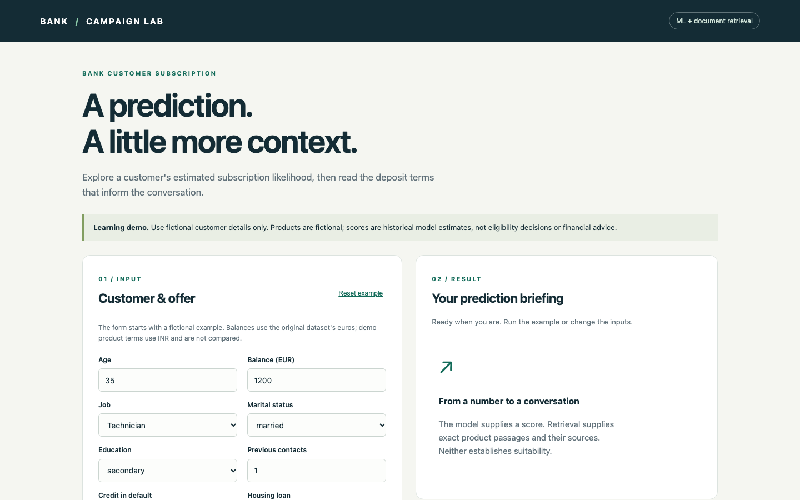
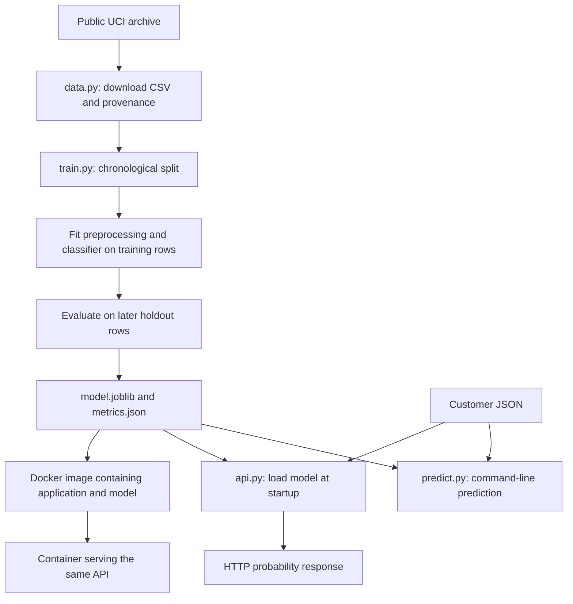
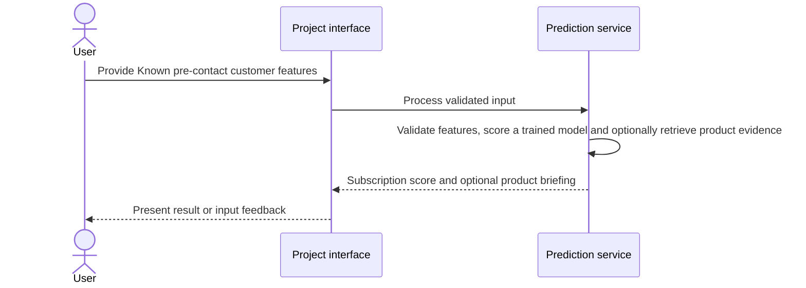
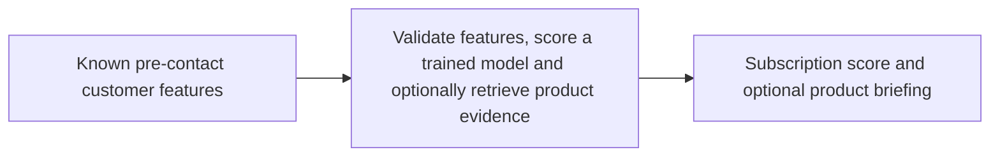
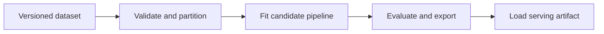
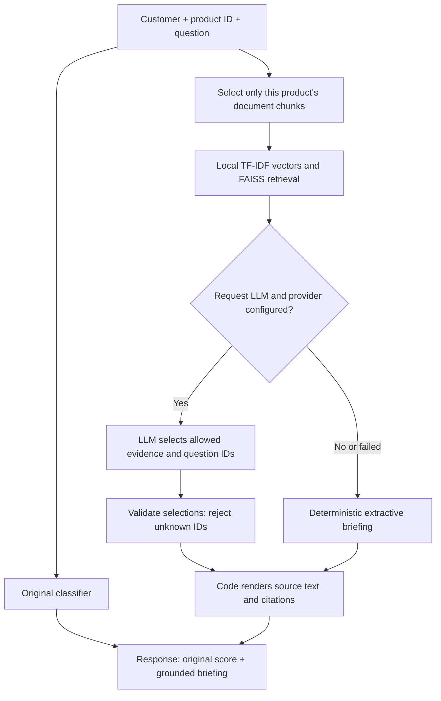

# Bank Customer Subscription ML Deployment

## 1. Project overview

Learn bank customer subscription prediction, APIs, Docker, CI/CD and AWS deployment from scratch.

[Live demo](https://bank-customer-subscription.onrender.com/) · [Source repository](https://github.com/subhashdixit/bank-customer-subscription-ml-pipeline) · [Complete engineering guide](PROJECT_GUIDE.md)



## 2. Motivation and problem statement

### Objective

Rank historical bank-marketing prospects by likely term-deposit subscription before contact.

### Problem statement

A calling team has limited capacity, and call outcomes cannot be used as pre-contact features.

### Motivation

A useful score helps prioritize calls within a fixed capacity and must be evaluated on later records.

## 3. Solution and scope

**Inputs** — Known pre-contact customer features. **Outputs** — Subscription score and optional product briefing.

This README is the single learning document. Read it from top to bottom; the contents below are shortcuts within this same file. Commands are tested for this macOS/Linux project setup. Do not paste every code block at once: servers occupy a terminal until stopped.

| Capability | Status |
| --- | --- |
| Public data download, preprocessing, training, evaluation | Implemented and tested |
| Saved model, command-line prediction, FastAPI service | Implemented and tested |
| Docker packaging and GitHub CI with real HTTP checks | Implemented and tested |
| FAISS product retrieval, cited excerpts, optional constrained LLM curation | Implemented; live provider call requires configuration |
| Flask form, checksummed baseline release, Render configuration | Implemented; live hosting evidence recorded below |
| Batch scoring CLI and managed model registry | Planned |
| EC2 CloudFormation template and SageMaker container wrappers | Implemented locally; real AWS verification pending |
| Monitoring, delayed-label evaluation, drift and retraining | Planned |

“Implemented” means executable project code exists. “Planned” means the concepts are explained here but working implementation and verification remain to be done. Chapters 35–38 provide AWS lab instructions and optional infrastructure files. They have not been applied to a real AWS account; permissions, quotas, networking and regional availability must be verified when you execute them.

No AWS resources have been created. Current training and serving run on your laptop, and CI runs on temporary GitHub runners. This repository is public; standard hosted runners for public repositories are free, while storage and other runner types have separate billing rules. Actual EC2/SageMaker usage cannot be guaranteed free without credits or a suitable sandbox. A budget alert is not a spending cap.

## 4. Quick start and usage

```bash
python -m bank_ml.predict --input examples/customer.json
```

JSON is a text format made of named fields and values. Our example customer is fictional. The program loads the saved model, checks the inputs, and prints a probability between zero and one. It does not retrain.

The probability is uncalibrated and based on this historical training distribution. Do not interpret a score as guaranteed real-world odds.

Exercise: copy the example into another local JSON file and change a field. Run the prediction with `--input` pointing at that file. A changed result is an association learned by the model, not proof that changing that characteristic causes subscription.

### Prediction code walkthrough


The CLI reads one customer object from JSON and wraps it in a list. The shared function also accepts multiple row objects internally, but no batch-file CLI is implemented. It validates a DataFrame and returns one probability object per row.

`joblib.load` must receive a trusted file: serialized Python objects can execute code when loaded. The saved model includes preprocessing; do not manually rescale API inputs yourself.

```bash
python -m uvicorn bank_ml.api:app --host 127.0.0.1 --port 8000
```

Uvicorn is the server process. `bank_ml.api:app` identifies the application object in our code. `127.0.0.1` means your own computer; `8000` is the listening port, like a numbered door for network requests. Keep this terminal open while you use the API.

Open http://127.0.0.1:8000/docs in a browser. FastAPI generates this interactive interface from our input schema. Expand `POST /predict`, choose “Try it out”, paste the example JSON, and execute.

In a second terminal opened in the project root, you can also run:

```bash
curl http://127.0.0.1:8000/health
curl -H 'Content-Type: application/json' --data @examples/customer.json http://127.0.0.1:8000/predict
```

`curl` sends HTTP requests. `--data @file` reads the request body from a file and uses POST. `Content-Type` tells the server how to read the body. GET `/health` asks whether the process is ready. POST `/predict` submits customer information. HTTP 200 means success; 422 means invalid input.

The model loads once at startup. Missing model files stop startup instead of returning fabricated predictions. Stop the server with Control+C. This development API has no authentication or rate limits and should not be exposed publicly.

### API code walkthrough


`Customer` defines the request body schema. FastAPI uses it to validate input and generate `/docs`. `lifespan` loads the model once at startup using `MODEL_PATH`, or its default path. If loading fails, startup fails. The application never silently substitutes an untrained model.

GET `/health` returns readiness for this simple application. It does not assess model quality or recheck disk contents on every request. POST `/predict` uses the already loaded model and converts ordinary validation failures to HTTP 422. Updating a model file on disk does not reload it into an already running process; restart that process or deploy a new container.

## 5. High-level architecture



**Training path:** many labelled rows become a fitted model and a report. Training is typically a separate job that finishes and exits.

**Serving path:** a running program receives a customer, checks it, transforms it with saved preprocessing, and predicts. It keeps running to handle more requests. It does not train on incoming requests.

**Automation path:** GitHub starts a temporary computer that repeats tests, synthetic smoke training and container checks. An optional manual job performs real-data training. That computer is removed after the job. It is not a permanent prediction server.

The intended full lifecycle is: business goal → versioned raw data → validation → training/validation/test → evaluated candidate → approval → versioned release → serving → monitoring → delayed outcomes → investigation → candidate retraining. Monitoring feeds back into development; it is not the last task before forgetting the model.

## 6. End-to-end request workflow



## 7. Data sources, inputs, and outputs

| Input | Processing | Output |
| --- | --- | --- |
| Known pre-contact customer features | Validate features, score a trained model and optionally retrieve product evidence | Subscription score and optional product briefing |

### Source and attribution

Dataset: Bank Marketing, UCI Machine Learning Repository, dataset 222.

Source: https://archive.ics.uci.edu/dataset/222/bank+marketing

Download: https://archive.ics.uci.edu/static/public/222/bank+marketing.zip

Creators credited by UCI: S. Moro, P. Rita, P. Cortez. Dataset DOI: https://doi.org/10.24432/C5K306

UCI lists the license as Creative Commons Attribution 4.0 International: https://creativecommons.org/licenses/by/4.0/

We use `bank-full.csv`, the original date-ordered 45,211-row version, not the 41,188-row `bank-additional-full.csv`. This project selects features and derives a binary label; it does not redistribute the raw dataset. Keep this attribution when reusing it.

### Prediction timing and features

The score is calculated before the current marketing contact. Features: age, balance, previous contact count, job, marital status, education, credit default, housing loan, personal loan, and previous campaign outcome. `unknown` is an explicit source category, not a missing Python value. New categories are encoded as all-zero indicators for that feature; prediction continues but may be less reliable.

We exclude duration because it is known only after the call. We also omit contact channel, current campaign count, day and month for a conservative first baseline. The source does not establish that every financial field was frozen at the exact scoring time. Historical leakage and repeated-customer effects therefore remain limitations. This is not a causal model.

### Evaluation

First 80% train, final 20% test, preserving source order. Do not shuffle these rows. This better resembles prediction on later campaigns than a random split, but record-level timestamps and customer IDs are absent from our selected source. The same person may appear across periods. No tuning is performed, and threshold 0.5 is only illustrative.

Average precision and ROC AUC describe ranking. Precision/recall at a fixed threshold describe a particular decision rule. The test positive rate is the random-ranking reference for average precision. Accuracy alone is not useful for this imbalanced target. Generated test fixtures validate code, not measured business performance.

### Intended use and limits

Educational demonstration only. No fairness audit, privacy review, probability calibration, modern population validation, or business cost analysis has been performed. Historical Portuguese bank marketing outcomes do not establish generalisation to other banks or countries. Age and marital information can raise important policy and fairness questions that must be assessed before operational use.

`joblib` model files must come from trusted builds because loading them can execute code. Model and preprocessing are serialized together. A different library version may be incompatible, so metrics record versions. Deployment should eventually use pinned dependencies, immutable model versions and explicit approval gates.

## 8. Data flow and ETL pipeline





### `model.py`: establish a shared contract

`NUMERIC` and `CATEGORICAL` define the feature lists. `validate_frame` selects those fields, rejects missing values, converts numeric values and checks finiteness and ranges. A pandas DataFrame is a table with named columns, similar to a spreadsheet held in memory.

`StandardScaler` learns each numeric column's mean and spread on training data. `OneHotEncoder` represents text categories with indicator columns. For example, a job could become separate technician and administrator indicators. `ColumnTransformer` sends each column group through the appropriate transformation.

`Pipeline` connects preparation and logistic regression into one object. `fit` learns preparation settings and model weights; `predict_proba` applies them to new rows. Logistic regression combines transformed values into a score and maps it to a value between zero and one. It is a classification algorithm despite its name.

[Complete engineering guide](PROJECT_GUIDE.md) covers training, reproducibility, AWS alternatives, and rollback in depth.

## 9. Low-level design and interfaces

Implementation entry points are [`src/bank_ml/api.py`](<src/bank_ml/api.py>), [`src/bank_ml/data.py`](<src/bank_ml/data.py>), [`src/bank_ml/model.py`](<src/bank_ml/model.py>), [`src/bank_ml/predict.py`](<src/bank_ml/predict.py>), [`src/bank_ml/web.py`](<src/bank_ml/web.py>).

| Field | Type | Meaning in this source |
| --- | --- | --- |
| `age` | Integer, 18–120 in the API | Age in years |
| `balance` | Finite number | Average yearly balance in euros; negative values are permitted |
| `previous` | Nonnegative integer in the API | Contacts before the current campaign |
| `job` | Nonempty text | Job category, such as technician |
| `marital` | Nonempty text | Marital status category |
| `education` | Nonempty text | Education category |
| `default` | Nonempty text | Whether credit is in default |
| `housing` | Nonempty text | Whether a housing loan exists |
| `loan` | Nonempty text | Whether a personal loan exists |
| `poutcome` | Nonempty text | Previous campaign outcome, including unknown |

These definitions describe the historical dataset; they are not a recommended production feature policy. See chapter 06 for fairness and timing limitations. `y` is the training answer, yes/no. It must not be submitted as a prediction feature.

The API forbids extra fields and validates types and ranges with Pydantic. The internal DataFrame validator selects known features and checks missing, finite and basic range values. It intentionally drops other CSV columns. These interfaces are not identical: the internal validator accepts some numeric conversions and does not require integer counts; the public API has integer fields. Categorical fields are not restricted to a fixed vocabulary; unseen categories are allowed and may reduce reliability.

## 10. Concepts and algorithms

Suppose 100 customers include 10 actual subscribers. A model flags 8 people and 4 of them are subscribers. Precision is 4/8 = 50%; recall is 4/10 = 40%. Those are different questions. Calling more people may increase recall while reducing precision; the business must choose the trade-off using validation data and costs.

| Report field | Meaning | Limitation |
| --- | --- | --- |
| `test_subscription_rate` | Fraction of yes labels in holdout | Describes this period only |
| `average_precision` | Summary of precision across recall levels | Depends on class prevalence |
| `roc_auc` | Ranking quality across thresholds | Does not establish useful calling economics |
| `precision_at_0_5` | Fraction of flagged customers who subscribed | Depends on the chosen threshold |
| `recall_at_0_5` | Fraction of subscribers flagged | Can be low even when precision is high |

Read the measured [validation record](PROJECT_GUIDE.md#31-validation-evidence-and-measured-limitations). It reports weak recall at 0.5 and a large subscription-rate difference between time periods. There is no automatic model-quality gate, tuning, probability calibration, or fairness evaluation. CI passing proves the implemented technical checks passed, not that the model is suitable to use in a bank.

Fitting preprocessing on all rows leaks information about later records. Including call duration leaks knowledge unavailable before the call. Tuning repeatedly against holdout scores leaks evaluation feedback into development decisions.

The current fixed baseline uses no validation set because it does no tuning. Before comparing many models, create separate chronological training, validation and test periods. Model selection belongs on validation data; final evaluation belongs on untouched test data. Date order is a useful approximation here, but missing customer identifiers limit our ability to exclude repeated customers across periods.

### What has changed in the same project?

The existing customer subscription model remains the source of the numerical score. A new `/predict/briefing` route accepts a customer, a selected demo product and a question. It returns that same score plus cited product information and follow-up questions. This is not a separate chatbot or a new predictive model.



The classifier is **not product-aware**: changing the selected product changes retrieved information, not its probability. Our historical training data has no matching product documents, so this integration cannot establish increased prediction accuracy. It improves the information delivered alongside the prediction.

### The fictional knowledge collection

`src/bank_ml/knowledge/deposits.json` contains two fictional demonstration products. Twelve-month terms specify INR 10,000 as the minimum; six-month terms specify INR 5,000. Each product has four short sections: minimum deposit, duration, withdrawal and eligibility. Interest rates are intentionally absent. These are project-authored learning examples, not real bank policies.

Each section is one chunk with a stable ID. A tiny source already divided into short sections does not need an arbitrary overlapping chunk splitter. For longer documents, preserve section/source metadata while splitting, and evaluate how chunk size affects retrieval.

The JSON is included as Python package data, so it is copied into the installed Docker application. `knowledge_version` identifies the authored collection, while `knowledge_sha256` fingerprints its exact bytes. Restart/rebuild after editing it. Old process memory and old images do not automatically acquire the new terms.

### What FAISS does here

`ProductKnowledge` fits one TF-IDF vectorizer and builds one FAISS `IndexFlatIP` per product at process startup. TF-IDF converts each section heading and its text into weighted word/bigram vectors; it requires no external model download or embedding API. We normalise vectors and use inner products as cosine similarity. [FAISS distance documentation](https://github.com/facebookresearch/faiss/wiki/MetricType-and-distances).

This is a **lexical retrieval baseline**, not neural semantic embeddings. Synonyms can be missed, and shared words can retrieve weak evidence. Only positive-overlap passages are returned, up to four; a zero-vector query returns no evidence. Positive overlap is not a calibrated confidence score. A production abstention policy needs an evaluated threshold and broader queries. Neural sentence embeddings are a future improvement requiring retrieval comparison, pinned model versions and corresponding index rebuilds.

Filtering happens before search by selecting a product-specific index, so another product's minimum cannot enter the candidate set. Indexes live in memory and are rebuilt from the small versioned JSON on startup. No separately managed vector database or persisted index service is required here. This is appropriate for eight chunks, not a claim about large-corpus scalability.

### Run the enriched prediction without any key

Use the earlier environment/training setup, then reinstall updated dependencies:

```bash
python -m pip install -e '.[dev]'
python -m uvicorn bank_ml.api:app --host 127.0.0.1 --port 8000
```

In another terminal at the repository root:

```bash
curl http://127.0.0.1:8000/products
curl -H 'Content-Type: application/json' --data @examples/briefing.json http://127.0.0.1:8000/predict/briefing
```

You can also use `/docs` and paste `examples/briefing.json` into POST `/predict/briefing`. `customer` contains the same ten fields used by the original endpoint. `product_id` chooses `demo-12-month` or `demo-6-month`; `question` controls retrieval; `use_llm` defaults to false. Unknown products return HTTP 404 when knowledge is available. Invalid customer fields return HTTP 422 before any LLM call.

The response includes:

| Field | Meaning |
| --- | --- |
| `subscription_probability` | Unmodified classifier result |
| `briefing.product` | Selected fictional product |
| `briefing.mode` | `extractive`, `llm_curated`, `no_evidence` or `unavailable` |
| `briefing.llm_status` | Why generation was used, skipped or unavailable |
| `briefing.product_information` | Exact excerpts linked by `source_id` |
| `briefing.sources` | Retrieved text, section, document, version and similarity |
| `briefing.questions_to_confirm` | Fixed safe follow-up questions |
| `briefing.knowledge_version` and `knowledge_sha256` | Collection provenance |
| `briefing.limitations` | Product, currency and model limitations |

No key is required for `extractive` mode. This mode is retrieval plus deterministic rendering, **not an LLM-generated answer**. It preserves the useful part of the response when a provider is unavailable.

### Example from the verified local container

For the committed `examples/briefing.json`, the unchanged model returned approximately **0.046237**, or **4.62%**. The response included these excerpts with source IDs:

- “The minimum opening deposit is INR 10,000.” — `demo12-minimum`
- “The deposit term is 12 months.” — `demo12-duration`
- “Early withdrawal is permitted with a penalty. The penalty amount is not specified in this demonstration document.” — `demo12-withdrawal`

The response also includes eligibility limitations and questions about intended amount, access to funds and separately checked eligibility. These are fictional product terms, not information about a real offer. The earlier conversational 18% example was illustrative; it is not this customer's measured model result.

### Optional LLM setup

The provider adapter expects an OpenAI-compatible `POST /chat/completions` API, not any arbitrary provider protocol. The base URL, model name and key must match your provider's documentation. No provider is assumed or preselected, and no key has been supplied or committed.

Set variables in the terminal where you start Uvicorn:

```bash
export LLM_BASE_URL='https://your-provider.example/v1'
export LLM_MODEL='your-model-name'
read -s LLM_API_KEY
export LLM_API_KEY
```

The `read -s` command waits for you to paste the key without echoing it. Restart Uvicorn in that environment. Change `use_llm` to true in a local copy of the example request. `.env.example` lists placeholders only; this application **does not automatically load `.env` files**. Docker users can explicitly pass a local ignored env file with `docker run --env-file .env ...`; never copy it into an image or Git.

When requested and configured, the adapter sends only the question and retrieved demonstration text to the provider. It does not send customer features, balance or score. Do not place private customer information in the question. Provider use may incur charges. Requests have a 15-second HTTP timeout, no redirects, no automatic retry, and a small output-token limit. This is a bounded demo, not a rate-limited public service. The URL is server configuration, not user input; HTTPS is required except for local development hosts.

### Why generated facts cannot replace source facts

The LLM is constrained to select source IDs and follow-up question IDs. Code rejects unknown IDs, malformed JSON, extra fields and empty evidence selections. It then renders exact text from the retrieved sources. No free-form LLM financial advice or generated numeric score is shown.

This is **constrained retrieval-augmented generation/curation**, rather than an unrestricted conversational assistant. It teaches the integration while reducing unsupported claims. Documents and questions are treated as untrusted content, not instructions. Allowlisting output IDs prevents a prompt from injecting a fabricated interest rate or another product's terms into the rendered answer. It does not guarantee the LLM always chooses the most relevant valid passage; relevance still needs evaluation.

`llm_status=not_configured` means one or more variables are missing. Network failure, provider errors, unsupported protocol or invalid output trigger extractive fallback. Logs do not print credentials or provider payloads. If knowledge loading or briefing construction fails, the enriched route preserves the numerical score with an unavailable notice. Original `/predict` remains independent of provider availability.

### Important interpretation limits

The historical `balance` field is in euros. Demo terms are in INR. We deliberately make no comparison between the two, infer no affordability and perform no currency conversion. Subscription likelihood is not eligibility or suitability. Retrieved terms cannot explain why the classifier produced its score. Model-specific attribution is a separate future implementation.

Unknown or unsupported questions may yield no evidence, but lexical overlap can still produce irrelevant excerpts. For example, asking an interest-rate question containing the word “deposit” may retrieve deposit passages without a rate. The application quotes those passages rather than inventing a rate; the user must see that the requested fact is absent. A larger evaluation set and better abstention remain necessary.

### Evaluation and CI

```bash
python -m pytest -q
python scripts/evaluate_retrieval.py
```

The new tests exercise product isolation, unknown questions, exact-source rendering, validated provider selections, forged source IDs, empty evidence, provider timeout/missing credentials, unchanged scores and knowledge failure isolation. Provider behaviour is simulated using HTTPX mock transport; no paid call is made by tests.

Six handwritten retrieval checks cover both products, expected top matches and a no-overlap query. They are a regression fixture, not a general benchmark or proof of semantic understanding. Expand it with paraphrases, misleading overlaps, missing facts and adversarial questions before claiming broader retrieval quality.

GitHub CI installs FAISS, runs tests and retrieval checks, trains a synthetic smoke-test model, builds the container and sends real HTTP requests to both prediction endpoints. `scripts/check_api.py` verifies the same numerical score and product-scoped citations in the running container. No LLM secret is needed in CI. Live provider compatibility cannot be verified until a provider is configured; simulated adapter tests are labelled as such.

For future monitoring, track retrieval hit/miss rates, question classes, response modes, provider timeouts, latency and cost, separately from predictive model metrics. Product-document updates require retrieval evaluation; they do not require classifier retraining. Keep the document hash, prompt/adapter version and provider model alongside release evidence. Public hosting, authentication, rate limits, neural embeddings and actual AWS deployment remain separate future work.

### Real-data training versus routine CI

The first RAG run passed tests/retrieval but failed on a 120-second UCI connection timeout. To keep software verification independent of that external source, routine CI now generates 300 deterministic synthetic rows using `scripts/make_smoke_data.py`. Its fitted model exists only for container/API checks, is not published as a release, and its metrics must not be presented as model-quality evidence. Local `python -m bank_ml.train` still uses real `data/bank-full.csv` by default and remains the source of the documented bank baseline metrics.

To request real-data hosted verification, open Actions → Test and build → Run workflow and enable `real_data`. The additional job downloads UCI data and trains/evaluates it, and can fail independently if UCI is unavailable. Previous real-data evidence remains historical; it is not relabelled as a new successful run. Dependency installation still requires package services and Docker image downloads; this change removes the live dataset dependency from normal checks, not every network dependency.

## 11. Technology choices and dependencies

- **Python**. Keep dataset preparation, fitting, and evaluation reproducible outside the serving path.
- **Flask**. Share the same service across interactive and HTTP entry points.
- **scikit-learn, Pydantic, and FAISS**. Train the subscription model, validate API requests, and retrieve optional product evidence.

## 12. Training, inference, and evaluation

### Local checks, 6 November 2026

- Python 3.10.0 on macOS; scikit-learn 1.7.2.
- Installed the project in an isolated virtual environment.
- Downloaded UCI bank-full.csv and recorded its SHA-256 and license metadata.
- Four pytest tests passed, covering training/save/load, prediction, API validation, leakage exclusion, unknown categories, and missing-model startup.
- One upstream TestClient deprecation warning was emitted; tests passed. This is a dependency migration notice, not a failed API request.
- Trained on 36,168 earlier rows and tested on 9,043 later rows.
- Saved measured results in [baseline-metrics.json](docs/baseline-metrics.json).
- CLI prediction returned approximately 0.04624 for the fictional example customer.

### How to interpret the first results

Average precision was 0.5501 versus a holdout subscriber rate of 0.3158. ROC AUC was 0.7173. At a threshold of 0.5, precision was 0.7042 but recall was only 0.0525: the model missed most subscribers at that threshold. We have not selected a useful operating threshold.

The earlier training period's subscriber rate was 0.0673, while the later holdout's rate was 0.3158. This large difference illustrates why future-looking evaluation matters. Campaign selection and population changes can affect results. We cannot infer the cause of this difference from these aggregate numbers alone. An apparently good ranking score does not establish well-calibrated probabilities or business suitability.

### Reproduce

Follow README commands from a fresh environment. Model/data files are generated locally, not committed. Dependencies are specified as ranges, so exact bytes or metrics may vary with future versions. Data SHA-256 and library versions are included in the report.

### Container verification

Built `bank-ml:local` with Docker Desktop 29.8.0. Started a temporary non-root container. GET `/health` returned `{"status":"ready"}`; POST `/predict` returned approximately 0.04624 for the example customer. The temporary container was removed after verification; the reusable image remains. The image uses Python 3.11, while the original laptop training used Python 3.10. The tested serialization loaded successfully, but cross-version compatibility should not be assumed for other builds.

### Hosted CI

Initial run: https://github.com/subhashdixit/bank-customer-subscription-ml-pipeline/actions/runs/42107025182

Result: **passed**, 1 minute 22 seconds. GitHub Linux/Python 3.11 installed dependencies, passed pytest, downloaded real data, trained the model, predicted the example, built Docker and checked the running container. This verifies a second environment in addition to the laptop.

GitHub emitted informational notices about Node.js action-runtime migration and the upcoming `ubuntu-latest` image change. The current run passed; future maintenance should update the action versions and choose an explicit runner image when strict reproducibility is needed.

The documentation-only follow-up commit uses `[skip ci]` to avoid repeating compute for an evidence update. The linked run validates the application and workflow commit.

No AWS resources have been created and no real cloud deployment has been verified.

### Full pipeline and documentation review, 6 November 2026

Reviewed all application modules, tests, Dockerfile, workflow and learning documents together. Fixed stale private-repository descriptions. Added the main study guide with an architecture diagram, input contract, module walkthrough, workflow explanation, metric examples, exercises and production limitations. Checked that local Markdown links resolve.

Repeated local pytest (4 passed), real-data training and CLI prediction. Results matched the earlier baseline. The existing upstream local TestClient deprecation warning remains informational.

Strengthened the actual container smoke check: health JSON, finite prediction in [0, 1], numerical parity with the saved host model, and HTTP 422 for invalid age. Updated checkout/setup-python to Node 24 action versions and selected Ubuntu 24.04 explicitly.

Updated code/workflow commit: `9e00682`.

Hosted verification: https://github.com/subhashdixit/bank-customer-subscription-ml-pipeline/actions/runs/42108135672

Result: **passed**, 48 seconds. Dependency install, tests, public download, training, CLI prediction, Docker build and strengthened HTTP checks all passed. The earlier action-runtime and runner-migration annotations were not emitted in this run. The follow-up evidence-only commit skips CI because no executable files change.

This verifies the currently implemented local/CI pipeline. AWS, persistent deployment, model registry, quality gates, monitoring and retraining remain planned rather than verified features.

### Single-document consolidation, 6 November 2026

Consolidated the learning material into this README and removed the seven separate Markdown guides. Added a single chapter sequence and same-page contents, preserving attribution, measured results, commands and limitations. Expanded conceptual coverage for batch data, versioning, EC2, SageMaker, delivery, monitoring, drift, retraining and scaling. These additions describe planned components and do not claim new executable features. Checked Markdown structure, local file links and internal contents anchors. This documentation-only change does not alter the previously verified application or workflow.

### Integrated retrieval verification, 8 November 2026

Code commit: `dd05d49`. Local checks passed: eight pytest tests, six retrieval regression cases and `pip check`. Built the updated Docker image and verified real HTTP health, numerical prediction, invalid-input rejection and `/predict/briefing` score parity/product-scoped citations. Removed the temporary container after verification. The example customer retained probability approximately 0.046237.

Optional provider success, invalid output, forged IDs and timeout behaviour were tested with HTTPX simulated responses. No live LLM provider call was made, no credentials were committed, and no AWS resources were created. The pre-existing local TestClient deprecation warning remains informational.

Hosted verification run: https://github.com/subhashdixit/bank-customer-subscription-ml-pipeline/actions/runs/42410350256

### Final integrated pipeline verification, 8 November 2026

Final executable revision: `c33ac18`. Hosted run [42410671032](https://github.com/subhashdixit/bank-customer-subscription-ml-pipeline/actions/runs/42410671032) **passed in 1 minute 11 seconds**: eight tests, six retrieval cases, synthetic software-check training, CLI prediction, Docker build, and real HTTP checks including the enriched briefing. The optional real-data job was deliberately skipped on this push. Initial run 42410350256 failed at the UCI download timeout; it is not a successful full run. The README-only evidence update skips CI.

This final evidence verifies the integrated ML/retrieval software and simulated LLM adapter, not a live LLM provider, model-quality improvement or AWS deployment. Chapter 33 explains how to enable the optional provider safely.

### Flask and Render deployment verification, 8 November 2026

Executable revision `2ae763b` passed [GitHub CI run 42412474525](https://github.com/subhashdixit/bank-customer-subscription-ml-pipeline/actions/runs/42412474525) in 1 minute 6 seconds, including ten tests, six retrieval checks, the web container and the local SageMaker-compatible wrapper. Local JavaScript syntax, Python compilation, README references and release integrity were checked. The EC2 template passed local `cfn-lint`; this does not verify actual AWS permissions, networking or startup.

Render service `bank-customer-subscription` was created on the **Free** plan in Oregon from that revision, with `/health`, LLM calls disabled, and subsequent auto-deploy configured for passing CI. Render reported “Deploy succeeded | Live.” The HTTPS page and original/enriched prediction endpoints passed real HTTP checks against the committed real-data release. Browser testing confirmed that the form displays the fictional example score (approximately 4.62%) and cited product terms.

The local web container used approximately 133 MiB under a 512 MiB limit during a smoke check; this is not a load/capacity guarantee. Temporary local web/inference containers are removed after verification. No paid Render tier or AWS resources were created. Live provider/LLM calls remain unconfigured and disabled for public requests.

[Complete engineering guide](PROJECT_GUIDE.md) covers training, reproducibility, AWS alternatives, and rollback in depth.

## 13. Limitations and data handling

Historical campaign scores require validation before operational use. The cloud examples are learning paths and may incur usage costs.

## 14. Installation and local setup

The terminal is an application where you type commands. Its current directory determines where files are read and written. Open a terminal in this project's root folder, the folder containing `pyproject.toml`.

On macOS, `pwd` prints the current folder and `ls` lists its contents. A command printed in a code block is something you can run; a filename in a paragraph is something you can open and read.


For a fresh clone, first run:

```bash
git clone https://github.com/subhashdixit/bank-customer-subscription-ml-pipeline.git
cd bank-customer-subscription-ml-pipeline
```

If you are already in the existing checkout, use it rather than cloning a second copy. On Windows, shell activation and path syntax differ; the current instructions and evidence cover macOS/Linux.

You need Python 3.10 or newer. Docker is needed only for the container lesson. Git records changes; GitHub hosts the repository online. You do not need an AWS account for these lessons.

```bash
python3 --version
pwd
ls
```

Expected: a supported Python version and project files. If a command is missing, use the troubleshooting guide rather than installing random packages.

```bash
python3 -m venv .venv
source .venv/bin/activate
python -m pip install --upgrade pip
python -m pip install -e '.[dev]'
```

`python3 -m venv .venv` creates a private set of Python tools in `.venv`. It does not create a virtual machine. `source` activates those tools in this terminal; activate again when you open another terminal. `python -m` runs a module using the selected Python interpreter.

`pip` installs libraries. `-e` means editable: when you change our Python source, the environment sees the changes. The quoted `.[dev]` means this project plus its development tools. Quotes prevent the shell treating brackets as filename patterns. `pyproject.toml` declares those requirements. Version ranges allow compatible updates; this is not a fully locked dependency environment.

Expected: installation finishes without an error. The `.venv` directory is ignored by Git because it is generated and specific to your machine. Do not use `sudo pip`.

## 15. Repository structure

| File or directory | Why it exists | Committed to Git? |
| --- | --- | --- |
| `pyproject.toml` | Package metadata and dependency requirements | Yes |
| `src/bank_ml/` | Importable application code | Yes |
| `tests/` | Repeatable checks with synthetic data | Yes |
| `scripts/check_api.py` | Smoke-check numerical and enriched predictions over HTTP | Yes |
| `src/bank_ml/rag.py` | FAISS retrieval, evidence rendering, optional LLM curation | Yes |
| `src/bank_ml/knowledge/deposits.json` | Fictional versioned product passages | Yes |
| `scripts/evaluate_retrieval.py` | Small retrieval regression set | Yes |
| `.env.example` | Placeholder provider configuration, never real secrets | Yes |
| `examples/customer.json` | Fictional valid input | Yes |
| `data/` | Downloaded raw CSV and provenance | Only its placeholder |
| `artifacts/` | Experiment outputs, regenerated by training | No |
| `release/` | Explicitly promoted, checksummed baseline model and evidence | Yes, small educational release snapshot |
| `render.yaml` | Free Render service definition | Yes |
| `infra/aws/` | Optional, billable EC2/SageMaker lab files | Yes |
| `src/bank_ml/web.py`, `templates/`, `static/` | Flask page and browser assets | Yes |
| `docs/baseline-metrics.json` | Explicit historical learning evidence | Yes |
| `.venv/` | Machine-specific Python environment | No |
| `.git/` | Local repository history and configuration | Managed by Git, never stage as application data |
| `.gitignore` | Prevent generated and sensitive files being staged by default | Yes |
| `.dockerignore` | Limit files sent to Docker build | Yes |
| `.github/workflows/ci.yml` | Instructions GitHub executes | Yes |
| `infra/` and `notebooks/` | Reserved for future infrastructure and exploration | Empty folders may not appear on GitHub |

The `src/` layout separates importable code from the README and generated files. Installing the package lets `python -m bank_ml.train` find it without manually changing Python's import path.

## 16. Deployment and operations

### One service, not two servers

Flask renders the customer form and serves CSS/JavaScript. FastAPI keeps the existing validated prediction routes. `a2wsgi.WSGIMiddleware` mounts Flask at `/` **after** the API routes, so `/docs`, `/predict`, `/products` and `/predict/briefing` remain reachable. Uvicorn serves the combined application as one process on one port. There is no Flask development server, browser-to-private-API URL, CORS workaround, Node build or second paid instance. [FastAPI WSGI integration](https://fastapi.tiangolo.com/advanced/wsgi/).

The browser sends JSON to its own origin, displays the score and exact retrieved excerpts, and exposes source IDs and limitations. Text is inserted using `textContent`, not untrusted HTML. Flask adds a restrictive content security policy to the page/assets. Browser validation helps usability; server validation remains authoritative. No customer records are saved by the application. Hosting access logs and providers have their own retention; use fictional inputs only.

The public form always uses extractive mode. `ALLOW_LLM_REQUESTS=false` also blocks attempts to enable provider calls through the API, preventing visitors from spending a configured provider key. This is a public learning demo without user accounts, not a bank production portal. Real customer data, private documents, provider calls or production use require authentication, request limits and an appropriate data-handling design.

### Run the exact release locally

```bash
python -m pip install -e '.[dev]'
PORT=8001 python -m bank_ml.serve
```

Open http://127.0.0.1:8001/ for the form; `/docs` remains available for developers. If that port is in use, choose another free port. The entry point binds on all interfaces to support containers; when running directly, use trusted local networks/firewall settings. For a localhost-only development process use `MODEL_PATH=release/model.joblib python -m uvicorn bank_ml.api:app --host 127.0.0.1 --port 8001`.

The form starts with the existing fictional customer, whose released model estimate is approximately 4.62%. Select the six-month product and run again: product terms change while the same customer's score stays unchanged. Try an unrelated question: no matching evidence should be reported for a no-overlap query. Reset restores the example. Loading and error states keep the interface usable when requests fail.

### The release boundary

`artifacts/` is for experiments. `release/` is a small, intentionally committed snapshot of the trusted UCI-trained baseline, containing a model, metrics and manifest. We commit this small snapshot to make free hosting reproducible without a dataset download on every build. This is an educational convenience; a larger system would use a versioned artifact store/registry and approvals instead of committing binary models.

`bank_ml.serve` checks model/report hashes and exact scikit-learn version **before** loading the model. Hashes detect a mismatch against the trusted manifest; they are not signatures or proof that an unknown model is safe. Never substitute untrusted joblib files. The original release was trained on Python 3.10 and is container-tested on Python 3.11; reproducible future releases should train in the deployment environment. Scikit-learn is pinned at 1.7.2; remaining dependencies/base image are not yet fully locked.

To promote a new trusted run after review:

```bash
python -m bank_ml.train
python scripts/promote_model.py --expected-data-sha256 d1513ec63b385506f7cfce9f2c5caa9fe99e7ba4e8c3fa264b3aaf0f849ed32d
```

This command checks that metrics refer to the explicitly expected dataset and copies the model/report into `release/`. It does not decide model quality for you. If the intended dataset changes, independently verify its provenance and supply its actual approved checksum, rather than blindly reusing this example. The script currently uses the baseline release label; update it for a genuinely new release. Review the diff, evaluation and manifest before committing. Never promote the synthetic CI model.

### Render configuration, explained

| Setting | Value | Reason |
| --- | --- | --- |
| Runtime | Docker | Use the tested Python environment |
| Plan | Free | User's zero-paid-hosting requirement |
| Region | Oregon | Matches the selected Render service; AWS lab region is independent |
| Branch | main | Deployment source |
| Dockerfile | `./Dockerfile` | Includes Flask, model and knowledge |
| Port | Hosting `PORT`, example 10000 | Must listen on `0.0.0.0`, not localhost |
| Health path | `/health` | Startup must load the model before readiness |
| Auto deploy | `checksPass` in `render.yaml` | Build after linked CI succeeds |
| LLM calls | Disabled | No API key or provider spend for public visitors |

`render.yaml` is infrastructure configuration, not a live service by itself. Blueprint deployments read it. A manually created web service must be configured equivalently; changing YAML does not automatically change a service that was never linked to a Blueprint. [Render Blueprint specification](https://render.com/docs/blueprint-spec), [Docker deployment](https://render.com/docs/docker).

Deployment sequence:

1. Sign in to Render, use the existing GitHub connection and select this repository.
2. Create a Web Service using Docker, branch main and the Free instance type. Do not select a paid tier or persistent disk.
3. Set health path `/health`; configure auto deploy after CI passes if using the connected Git provider.
4. Keep LLM calls disabled; there are no secrets needed for this demonstration.
5. Render clones the commit, builds the image and starts `python -m bank_ml.serve`. It verifies the release, loads the model and builds the tiny FAISS indexes.
6. After health succeeds, Render routes HTTPS traffic to the process and assigns an `onrender.com` URL. Test the page, predictions and product switching at that actual URL.
7. On later updates, observe both CI and Render deployment status. A GitHub push alone is not proof that the new service is healthy.

Free services sleep after 15 minutes without traffic and can take around a minute to wake. The filesystem is ephemeral; this app rebuilds its small index and uses bundled release files rather than storing user uploads or mutable databases. The workspace's free hours/build/bandwidth allowances are shared with other services; check total usage, especially if the account hosts several demos. No keep-alive workaround is used. [Render free limitations](https://render.com/docs/free).

### What Render teaches versus AWS

Render handles VM allocation, process supervision, HTTPS routing and much of deployment orchestration. The model/container/API responsibilities are ours. On EC2 we must explicitly manage those hosting responsibilities. The following labs use the **same release and code**, so Render is a free demonstration venue, not a replacement for learning AWS.

[Complete engineering guide](PROJECT_GUIDE.md) covers training, reproducibility, AWS alternatives, and rollback in depth.

## 17. License, credits, and support

The repository does not contain a root LICENSE file. Check upstream and data-source terms before reuse. Report reproducible issues through [GitHub Issues](https://github.com/subhashdixit/bank-customer-subscription-ml-pipeline/issues).
