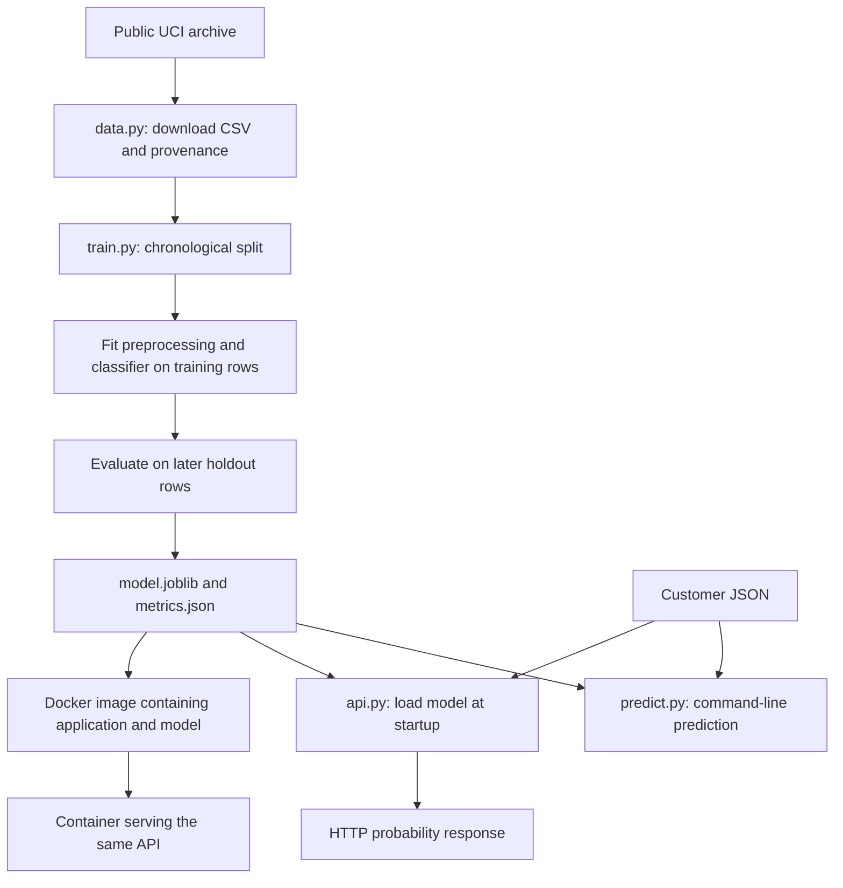

# Bank ML deployment: your study guide

Use this page as the table of contents for your learning. It explains how the pieces connect; the [hands-on handbook](01-beginner-handbook.md) supplies the commands. You can read both without knowing AWS.

## 1. What this project solves

A bank offers a term deposit: a customer places money with the bank for an agreed period. The bank has historical marketing results and wants to prioritise future contacts. Our model estimates subscription likelihood before the current call.

The input is one customer's known information. The output is a number between 0 and 1. The application does not contact customers, approve loans, move money, or guarantee a subscription. The example JSON is fictional. Our model is a learning baseline, not an approved banking system.

“End to end” has a specific scope here: downloading data, training, evaluating, saving, loading, serving through HTTP, packaging in Docker, and automatically checking those steps on GitHub. Persistent cloud deployment is not implemented yet. See the final section for the remaining learning path.

## 2. Read in this order

| Lesson | Read | You should be able to explain |
| --- | --- | --- |
| 1 | This guide, sections 1–5 | The problem, inputs, outputs and architecture |
| 2 | Handbook, sections 2–4 | Terminal, environment, dependencies, data download |
| 3 | Data card and this guide, sections 6–8 | Features, leakage, training and evaluation |
| 4 | Handbook, sections 6–7 | Prediction versus training, API and HTTP |
| 5 | Handbook, sections 8–9 | Tests, images, containers and ports |
| 6 | This guide, sections 10–12 | Workflow execution, failure diagnosis and reproducibility |
| 7 | Exercises below | Perform changes and predict their effects |
| 8 | AWS roadmap | Which cloud service replaces which local responsibility |

Do not memorise commands without understanding their inputs and outputs. After each lesson, explain it aloud in two sentences and run its exercise.

## 3. Three different paths through the system



**Training path:** many labelled rows become a fitted model and a report. Training is typically a separate job that finishes and exits.

**Serving path:** a running program receives a customer, checks it, transforms it with saved preprocessing, and predicts. It keeps running to handle more requests. It does not train on incoming requests.

**Automation path:** GitHub starts a temporary computer that repeats tests, training and container checks. That computer is removed after the job. It is not a permanent prediction server.

## 4. Understand the directory structure

| File or directory | Why it exists | Committed to Git? |
| --- | --- | --- |
| `pyproject.toml` | Package metadata and dependency requirements | Yes |
| `src/bank_ml/` | Importable application code | Yes |
| `tests/` | Repeatable checks with synthetic data | Yes |
| `scripts/check_api.py` | Smoke-check an actual running HTTP service | Yes |
| `examples/customer.json` | Fictional valid input | Yes |
| `data/` | Downloaded raw CSV and provenance | Only its placeholder |
| `artifacts/` | Generated model and metrics | No |
| `docs/baseline-metrics.json` | Explicit historical learning evidence | Yes |
| `.venv/` | Machine-specific Python environment | No |
| `.git/` | Local repository history and configuration | Managed by Git, never stage as application data |
| `.gitignore` | Prevent generated and sensitive files being staged by default | Yes |
| `.dockerignore` | Limit files sent to Docker build | Yes |
| `.github/workflows/ci.yml` | Instructions GitHub executes | Yes |
| `infra/` and `notebooks/` | Reserved for future infrastructure and exploration | Empty folders may not appear on GitHub |

The `src/` layout separates importable code from documentation and generated files. Installing the package lets `python -m bank_ml.train` find it without manually changing Python's import path.

## 5. Input contract: what every customer field means

| Field | Type | Meaning in this source |
| --- | --- | --- |
| `age` | Integer, 18–120 in the API | Age in years |
| `balance` | Finite number | Average yearly balance in euros; negative values are permitted |
| `previous` | Nonnegative integer in the API | Contacts before the current campaign |
| `job` | Nonempty text | Job category, such as technician |
| `marital` | Nonempty text | Marital status category |
| `education` | Nonempty text | Education category |
| `default` | Nonempty text | Whether credit is in default |
| `housing` | Nonempty text | Whether a housing loan exists |
| `loan` | Nonempty text | Whether a personal loan exists |
| `poutcome` | Nonempty text | Previous campaign outcome, including unknown |

These definitions describe the historical dataset; they are not a recommended production feature policy. See the data card for fairness and timing limitations. `y` is the training answer, yes/no. It must not be submitted as a prediction feature.

The API forbids extra fields and validates types and ranges with Pydantic. The internal DataFrame validator selects known features and checks missing, finite and basic range values. It intentionally drops other CSV columns. These interfaces are not identical: the internal validator accepts some numeric conversions and does not require integer counts; the public API has integer fields. Categorical fields are not restricted to a fixed vocabulary; unseen categories are allowed and may reduce reliability.

## 6. Walk through the Python code

### `data.py`: bytes become a dataset

`URL` identifies the UCI download. `urlopen` performs an HTTPS request with a timeout. `ZipFile` reads the outer archive and the nested `bank.zip`. The code selects `bank-full.csv` and writes those bytes, rather than extracting arbitrary file paths from an archive. If UCI changes its archive structure, this code can fail and needs review.

`hashlib.sha256` fingerprints the CSV. The `.source.json` records that fingerprint, source and license. It does not independently authenticate the dataset or freeze future downloads. A rerun replaces these local output files. The loader reads the archive into memory, which is reasonable for this small dataset, not a general large-data download design.

### `model.py`: establish a shared contract

`NUMERIC` and `CATEGORICAL` define the feature lists. `validate_frame` selects those fields, rejects missing values, converts numeric values and checks finiteness and ranges. A pandas DataFrame is a table with named columns, similar to a spreadsheet held in memory.

`StandardScaler` learns each numeric column's mean and spread on training data. `OneHotEncoder` represents text categories with indicator columns. For example, a job could become separate technician and administrator indicators. `ColumnTransformer` sends each column group through the appropriate transformation.

`Pipeline` connects preparation and logistic regression into one object. `fit` learns preparation settings and model weights; `predict_proba` applies them to new rows. Logistic regression combines transformed values into a score and maps it to a value between zero and one. It is a classification algorithm despite its name.

### `train.py`: create a model and measure its behaviour

`argparse` reads optional `--data` and `--output` command arguments. `Path` handles file locations. Pandas loads the semicolon-separated CSV. The code checks yes/no labels, a minimum row count and that both chronological partitions contain both outcomes.

The first 80% is training data; the final 20% is the holdout. The scaler, encoder and classifier learn only from training rows. `predict_proba(... )[:, 1]` selects the probability for class 1, which is subscription because yes was converted to 1 and no to 0.

Metrics describe the holdout. `joblib.dump` serializes the fitted pipeline so another process can load it. The JSON report records selected/excluded columns, source checksum and software versions. Training currently overwrites the selected output directory's model and report. Use a different `--output` directory to keep an experiment separate, but remember that the API must then be pointed at its model.

### `predict.py`: use, rather than recreate, the model

The CLI reads one customer object from JSON and wraps it in a list. The shared function also accepts multiple row objects internally, but no batch-file CLI is implemented. It validates a DataFrame and returns one probability object per row.

`joblib.load` must receive a trusted file: serialized Python objects can execute code when loaded. The saved model includes preprocessing; do not manually rescale API inputs yourself.

### `api.py`: accept HTTP requests

`Customer` defines the request body schema. FastAPI uses it to validate input and generate `/docs`. `lifespan` loads the model once at startup using `MODEL_PATH`, or its default path. If loading fails, startup fails. The application never silently substitutes an untrained model.

GET `/health` returns readiness for this simple application. It does not assess model quality or recheck disk contents on every request. POST `/predict` uses the already loaded model and converts ordinary validation failures to HTTP 422. Updating a model file on disk does not reload it into an already running process; restart that process or deploy a new container.

## 7. Interpret the results, not just the commands

Suppose 100 customers include 10 actual subscribers. A model flags 8 people and 4 of them are subscribers. Precision is 4/8 = 50%; recall is 4/10 = 40%. Those are different questions. Calling more people may increase recall while reducing precision; the business must choose the trade-off using validation data and costs.

| Report field | Meaning | Limitation |
| --- | --- | --- |
| `test_subscription_rate` | Fraction of yes labels in holdout | Describes this period only |
| `average_precision` | Summary of precision across recall levels | Depends on class prevalence |
| `roc_auc` | Ranking quality across thresholds | Does not establish useful calling economics |
| `precision_at_0_5` | Fraction of flagged customers who subscribed | Depends on the chosen threshold |
| `recall_at_0_5` | Fraction of subscribers flagged | Can be low even when precision is high |

Read the measured [validation record](06-validation.md). It reports weak recall at 0.5 and a large subscription-rate difference between time periods. There is no automatic model-quality gate, tuning, probability calibration, or fairness evaluation. CI passing proves the implemented technical checks passed, not that the model is suitable to use in a bank.

## 8. Why the holdout must stay separate

Fitting preprocessing on all rows leaks information about later records. Including call duration leaks knowledge unavailable before the call. Tuning repeatedly against holdout scores leaks evaluation feedback into development decisions.

The current fixed baseline uses no validation set because it does no tuning. Before comparing many models, create separate chronological training, validation and test periods. Model selection belongs on validation data; final evaluation belongs on untouched test data. Date order is a useful approximation here, but missing customer identifiers limit our ability to exclude repeated customers across periods.

## 9. Docker, explained instruction by instruction

| Instruction | Effect |
| --- | --- |
| `FROM python:3.11-slim` | Start with a Linux image containing Python |
| `WORKDIR /app` | Set the directory for later instructions and startup |
| `COPY pyproject.toml` and `COPY src` | Include package definition and source |
| `RUN pip install ...` | Install runtime dependencies during build |
| `useradd` and `USER appuser` | Run the final service without root privileges |
| `COPY artifacts/model.joblib` | Freeze this model into the image |
| `EXPOSE 8000` | Document the intended container port; does not publish it |
| `CMD ... uvicorn` | Start the API when the container runs |

Training happens before this build. ECR is not involved locally. `docker run -p 127.0.0.1:8000:8000` publishes the port to your laptop only. Inside the container, Uvicorn listens on all container interfaces so Docker forwarding can reach it. The image bundles a model; changing the host file afterwards does not change that image.

The base-image tag and dependency ranges can change over time. This project has not yet locked every dependency or pinned the base-image digest. A production release should capture those identities and train using the same environment used for serving. Successful cross-version loading in one test is not a general compatibility promise.

## 10. GitHub Actions, step by step

The current job uses Ubuntu 24.04 and Python 3.11. GitHub's action runtime is separate from application Python: checkout/setup actions use Node.js internally, while our model runs in Python.

| Workflow component | What happens | Typical failure |
| --- | --- | --- |
| `on` | Start on push, pull request or manual dispatch | Actions disabled or YAML invalid |
| `permissions` | Give automation read access to repository contents | Unneeded write operations are rejected |
| `runs-on` | Allocate a temporary Linux runner | Runner service unavailable |
| `timeout-minutes` | Stop a job that exceeds 15 minutes | Slow dependency or data service |
| Checkout action | Retrieve this commit's files | Repository access or action service issue |
| Setup Python action | Select Python 3.11 | Runtime download problem |
| Install | Build our package and install dependencies | Dependency resolution/network error |
| Pytest | Check code using generated data | Behaviour differs from assertions |
| Download | Fetch real UCI data | External source unavailable |
| Train | Fit and evaluate on real data | Schema/label error |
| Predict | Load artifact and score example | Model or input mismatch |
| Build | Package application and model | Missing artifact or failed installation |
| Smoke check | Start container and probe actual HTTP requests | Startup, routing, contract or model mismatch |

The readiness loop tries `/health` up to 30 times, waiting two seconds between attempts. Once ready, `scripts/check_api.py` checks health JSON, a finite probability in range, numerical agreement with the host model, and rejection of an invalid age. A trap prints container logs and removes the temporary container when the shell exits, including when a check fails. Model comparison uses a small numerical tolerance to allow tiny floating-point differences.

The smoke script accepts `--url` for another local port and expects to run from the project root with the matching host artifact. A mismatch can indicate that the image contains an older model. It is stronger than merely checking that HTTP returned success.

This is continuous integration. There is no registry push, persistent deployment, release approval, rollback automation or AWS authentication yet. The workflow does not retain its trained model as a downloadable release artifact. CI currently retrains on every triggering change, including documentation pushes unless explicitly skipped. This is simple for learning but inefficient for a larger project.

Updated action runtime references: [checkout](https://github.com/actions/checkout), [setup-python](https://github.com/actions/setup-python). Billing reference: [GitHub Actions billing](https://docs.github.com/en/billing/concepts/product-billing/github-actions).

## 11. Verify the full pipeline yourself

Follow the handbook setup, download and training commands first. From the activated project environment:

```bash
python -m pytest -q
python -m bank_ml.train
python -m bank_ml.predict
docker build -t bank-ml:local .
docker run --rm --name bank-ml -p 127.0.0.1:8000:8000 bank-ml:local
```

In another terminal at the project root:

```bash
source .venv/bin/activate
python scripts/check_api.py
```

Expected: a PASS message describing the checked behaviour. Stop the foreground container with Control+C. The image remains available for reuse. If port 8000 is occupied, map laptop port 18000 instead and run the smoke script with `--url http://127.0.0.1:18000`.

After pushing code, open GitHub → repository → Actions → Test and build → latest run. Check its commit matches your change, expand failing steps, and read the first meaningful error. A green older run does not validate newer untested code. Documentation-only commits can use `[skip ci]`; do not use that to bypass verification of code changes.

## 12. Failure practice and checkpoint answers

| Exercise | Expected lesson |
| --- | --- |
| Send age -1 through `/docs` | HTTP 422; validation happens before prediction |
| Omit `job` | Missing required input is rejected |
| Add `duration` to the API input | Extra fields are rejected by the API |
| Use a new job category | Request is accepted; unknown-category encoding does not imply reliability |
| Start with `MODEL_PATH` pointing at a nonexistent file | Startup fails; health never becomes ready |
| Change a local JSON input | Predictions may change without retraining |
| Train into a different output directory | The default API still uses its default model unless configured |
| Change a model after building an image | Existing image still contains its build-time model |
| Stop the server and request health | Connection fails; no process is listening |
| Read metrics before celebrating a green CI run | Software correctness and useful model performance differ |

Checkpoint answers: S3 would store data, not execute this API. Training fits parameters; inference uses them. The image is a template; the container runs it. Git saves local history; GitHub hosts and automates it. A model file is an artifact, not source code. An AWS budget alert is not a guaranteed spending cap.

## 13. What is still missing for a production or AWS system?

The project does not yet implement an S3 storage adapter, AWS infrastructure, SageMaker conventions, ECR publication, authentication, TLS termination, request limits, operational alarms, drift monitoring, a model registry, quality approval gates, or automated retraining. Dependency locking and immutable releases also remain to be added. Do not describe a local mock as a real AWS integration test.

Read the [AWS roadmap](03-aws-roadmap.md) for the staged implementation. First practise storage through local files and mocked S3 APIs. Then add model version manifests, release selection and rollback. Next add monitoring and retraining. Finally prepare IAM, S3, ECR and either EC2 or SageMaker hosting, with cost estimates and cleanup for each resource before creating it.

Real AWS verification requires access and may cost money without credits. The current pipeline makes no AWS calls and does not need AWS credentials. The documentation explains future architecture without claiming that those resources have already been deployed.
